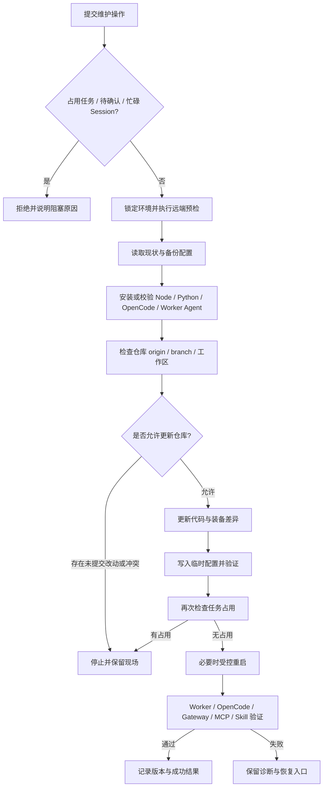

# Nexus v1.4.5｜Agent Worker 部署与运维优化——需求与设计定稿

> 基线：`linxuyiyi/Astra` 仓库 `nexus-v1.4.2` 分支，2026-10-19 静态源码审查。**本版本只处理 Agent Worker 部署、装备、维护及其运行状态呈现；主控部署属于 v1.4.4。**
>
> 产品原则：Nexus 是独立产品，不兼容历史版本；数字员工定义身份与职责，Agent Worker 是可部署、可调度的执行资源，**Worker ≠ 数字员工 ≠ SubAgent**。沿用现有 OpenCode、Worker Gateway、WebSocket、systemd，不另造执行框架。

## 一、审查结论

现有 Worker **不是空白实现**。源码已有：远程 SSH 安装与离线维护、OpenCode npm 固定版本安装、Python Worker Agent wheel、systemd 单元、Worker 主动 WebSocket 连接、token/epoch 认证、心跳重连、任务占用保护、Gateway/MCP/Skill 装备、Git 仓库绑定、Worker 文件与 HTTP 通道、测试用例。**这些能力应保留复用。**

### 1.1 已确认的实现问题

| ID | 优先级 | 事实与证据 | 影响 |
|---|---|---|---|
| W01 | P0 | `api/environment_routes.py` 的部署操作由 HTTP StreamingResponse 内创建的 asyncio task 执行，流关闭时 `task.cancel()`；`remote_provisioning.py` 捕获 CancelledError 并结束操作 | 浏览器断开可中断远端部署，操作不具备独立持续执行能力 |
| W02 | P0 | `remote_provisioning.py::_finish` 将维护失败统一写为 `EnvironmentStatus.UNAVAILABLE` | 安装或重启操作失败与 Worker 实际不可用混为一谈，可能错误影响调度 |
| W03 | P1 | `remote_install.sh` 安装 Node/npm/OpenCode、仓库、配置和 Skill；`_install_units` 另外安装 Worker Agent、写 token、启动 systemd；失败时主要依靠显式重试，非事务式 | 部分安装、配置已变更或凭据已轮换时，恢复结果不直观 |
| W04 | P1 | `remote_install.sh` 对已有仓库检查 origin 和当前分支，但不执行 fetch/pull；新仓库才 clone | 一键“重新部署”不等于代码同步；可能运行旧工程代码 |
| W05 | P1 | `remote_provisioning.py::_install_units` 写 `/etc/systemd/system/nexus-opencode-{environment.id}` 与 `nexus-worker-{environment.id}`，并执行 enable/start/restart | 部署更新时存在直接重启的动作，必须严格维持占用检查与维护锁；缺少独立的升级预览与差异核对 |
| W06 | P1 | `worker_agent/supervisor.py` 明确是占位类，`status` 返回 `opencode: unmanaged`；实际进程由 systemd 管理 | 不能把 supervisor 的状态当成真实 OpenCode 健康信息；监控应读取真实服务/接口 |
| W07 | P2 | `worker_routes.py` 的 `/api/workers` 仍是历史员工列表只读别名；部署入口按 `employee_id`，Worker 实例按 `environment_id` 登记 | 资源管理语义与“一岗一员工、Worker Pool 调度”不够清晰，容易在界面与 API 中混淆 |
| W08 | P2 | 远程安装仍包含 `ASTRA_*` 变量、`astra-gateway` provider 和 `astra-backup` 命名 | 独立 Nexus 产品存在历史标识残留；清理时必须连同协议、配置和测试一起修改 |

### 1.2 已有保护，不得重复开发

- `reserve_operation()` 使用条件更新与租约排他，检查占用任务、未结束 Session；`_native_idle()` 检查原生 OpenCode 忙碌状态。
- 远端 `remote_install.sh` 使用 `flock` 防并发安装；固定 Node/OpenCode 版本并校验可执行文件版本。
- 已有 Worker token、epoch、心跳、重连和 request_id 去重；断线不应自动重启 OpenCode。
- 配置合并会保留其他 provider/MCP 设置、备份旧配置，Skill 安装不会直接覆盖工程仓库中的 `.opencode/skills`。
- 失败时会记录步骤，且有网关 Key 的创建/撤销逻辑；这些不是“完全没有失败处理”。

### 1.3 待验证事项（不作为已确认缺陷）

- Worker 离线、OpenCode 健康、任务状态三者在真实断网/重启时是否始终一致。
- systemd 启动用户与 `/etc/nexus`、`/opt/nexus` 权限在 root/非 root 远端环境中的兼容性。
- `skill_refs`/`mcp_refs` 配置变更后的差异检测、重部署生效及残留清理。
- Git 凭据在克隆后执行 fetch/pull/push 的实际可用性；不能仅凭首次 clone 成功判断完整 Git 能力。
- 多 Worker 同主机时端口、工作目录、用户权限、npm 和 systemd 的资源隔离。
- 已有 `tests/test_remote_provisioning.py` 等测试覆盖上述场景的充分性，需运行而不是仅凭文件存在断言通过。

## 二、v1.4.5 目标与边界

**目标：让一个 Agent Worker 可以可靠地创建、部署、装备、检查、升级、重启、恢复和退出维护，且不损害正在执行或等待人工确认的任务。**

本版本不做：重写 WebSocket/Worker Gateway 协议；重写 Task/Session 状态机；改数字员工职责模型；把 Worker 改成 SubAgent；引入 Kubernetes；主控安装流程整改；强制统一每个 Worker 的仓库（每个 Worker 保留一个目标工程仓库，可按工程类型配置）。

## 三、功能需求定稿

| 编号 | 优先级 | 需求 | 验收标准 |
|---|---|---|---|
| R01 | P0 | **维护任务持久化**：部署/重启由服务端持久化操作驱动，HTTP 只提交与订阅 | 断开浏览器后操作继续；刷新可查询阶段、日志、最终结果；取消必须显式请求 |
| R02 | P0 | **状态分离**：维护操作状态、Worker 连接状态、OpenCode 健康状态、可调度状态分别计算 | 部署失败但旧 Worker 仍健康时不得无条件置 `UNAVAILABLE`；调度以实时条件判定 |
| R03 | P0 | **任务保护**：所有会中断 OpenCode/更改运行配置的操作必须检查占用、待人工确认和原生 Session 忙碌 | 任一保护条件成立，拒绝维护并展示阻塞对象；锁定后至重启前再次检查，防竞态 |
| R04 | P1 | **部署可重试与恢复**：各阶段幂等，维护中断后识别已完成步骤，重试不破坏原环境 | 模拟安装失败、进程退出、网络中断后可明确重试或恢复；旧配置/服务可保留时不被破坏 |
| R05 | P1 | **工程仓库完整管理**：仓库 URL、目标分支、认证方式、工作目录及代码版本明确 | 首次 clone、已有仓库核对、更新前检查工作区变更；不自动覆盖本地修改；部署结果记录 commit |
| R06 | P1 | **装备一致性**：统一模型、MCP、Skill、Git 凭据、OpenCode 版本的期望配置与实际状态 | 显示“已配置/已部署/已验证/异常”；变更时计算差异，仅必要时更新和重启 |
| R07 | P1 | **真实健康检查**：分别验证 Worker Gateway 在线、OpenCode API、模型网关认证、MCP 连接、Skill 实际发现 | 不能仅以端口监听、systemd active 或 Worker online 宣告可用；明确失败环节 |
| R08 | P1 | **Worker 生命周期操作**：部署、检查、重启、更新、禁用、恢复的入口和语义一致 | 线上优先走 Worker 通道，离线维护使用 SSH；所有破坏性操作统一走任务保护和审计 |
| R09 | P2 | **界面与术语归一**：Agent Worker 页面展示执行资源，不与数字员工混用 | 展示环境、仓库、装备、连接、健康、当前任务、最近维护记录；历史别名只在确认无调用后删除 |
| R10 | P2 | **Nexus 命名清理**：消除对外 ASTRA 标识 | 对外服务、日志、环境模板、文档统一 Nexus；内部兼容键在同版本整体替换并完成回归，不做历史兼容层 |

## 四、技术设计

### 4.1 资源模型：保持现有关系，修正职责边界

```text
数字员工（职责 / 身份 / 能力）
      │ 创建 / 分派数字任务
      ▼
Task / RuntimeSession（业务事实源）
      │ 选择可用执行资源
      ▼
Agent Worker（资源记录 / 环境配置）
      ├── Git Repository + Credential + Workspace
      ├── OpenCode Serve（执行 Session）
      ├── Worker Agent（主动 WebSocket）
      └── MCP / Skill / Model Gateway（装备）
                 │
                 ▼
       Worker Gateway（主控通信）
```

**决策**：不在 v1.4.5 强行做“Worker 与员工解绑”的数据库大迁移。现有 `OpenCodeExecutionEnvironment.employee_id`、`WorkerInstance.environment_id` 先保留，API/UI 对外明确资源语义；独立资源池的多对多调度属于另一个架构决策，待调度器证据审查后另立版本。这样不破坏当前 Task/Session/Worker 的已运行链路。

### 4.2 维护任务独立化

建议新增 `worker_maintenance_operations`（也可复用现有操作表，但须满足字段及独立执行要求）：

- `id`、`environment_id`、`action`、`state`、`stage`、`requested_by`、`requested_at`、`started_at`、`finished_at`、`lease_until`、`attempt`。
- `target_revision`（OpenCode/Worker Agent/Skill/MCP/仓库版本摘要）、`before_snapshot`、`after_snapshot`、`error_code`、`error_message`、`cancel_requested`。
- 步骤日志独立存储，敏感字段脱敏；可按 `operation_id` 分页查看。
- 状态：`QUEUED → PREFLIGHT → RUNNING → VERIFYING → SUCCEEDED`；失败进入 `FAILED`，人工取消进入 `CANCELED`，进程失联进入 `INTERRUPTED` 待核对；不把 `INTERRUPTED` 直接判为部署失败或 Worker 不可用。
- 提交操作后由后台执行器领取；进程崩溃时租约到期，恢复器先探测远端真实状态，再决定继续/重试/人工处理；**禁止盲目重复轮换 token 或重复重启 OpenCode**。

API 设计（示意，不要求沿用旧路由）：

```text
POST /api/agent-workers/{id}/maintenance          提交操作，返回 operation_id
GET  /api/agent-workers/{id}/maintenance           历史记录
GET  /api/maintenance/{operation_id}               状态与阶段
GET  /api/maintenance/{operation_id}/events        SSE 日志订阅（可重连）
POST /api/maintenance/{operation_id}/cancel        显式取消
POST /api/maintenance/{operation_id}/retry         显式重试
GET  /api/agent-workers/{id}/health                多维健康与装备差异
```

### 4.3 部署与更新流程



- Git 更新必须有显式操作语义：`check` 只检查；`deploy` 初装；`update` 才获取目标提交并更新。禁止“重新部署”暗中 `git reset --hard`。
- 配置写入采用临时文件 + 校验 + 原子替换；先保留旧配置及服务定义，成功后清理过期备份。
- 对于已经启动的 Worker，升级 Worker Agent 不能把自己的通信中断误报为失败；重启前持久化操作阶段，重连后按新 epoch 重新验证。
- 无法安全自动回滚的 Git 工作区、数据库、凭据变更必须明确提示“需人工恢复”，不得承诺全自动回滚。

### 4.4 状态计算与任务保护

**状态分四类**：

1. `maintenance_state`：最近一次维护动作的执行情况。
2. `connection_state`：Worker Gateway 当前在线/离线及最后心跳。
3. `runtime_health`：OpenCode 接口、模型网关、MCP、Skill/仓库装备健康。
4. `schedulable`：以上满足要求，且没有维护锁、占用冲突或管理禁用。

维护失败**不得直接覆盖**此前健康状态；但健康探测失败必须如实反映，调度仍需保守拒绝。待人工确认任务必须保持 Worker 占用，不允许更新或重启；正常 WebSocket 断线不自动重启 OpenCode、不释放仍被任务持有的 Worker。

### 4.5 Worker 管理页面

沿用现有 Element Plus 页面，不重做 UI 框架。列表展示：名称、服务器、目标仓库、连接状态、OpenCode 健康、当前任务、维护状态。详情分为“基础环境 / 代码仓库 / 装备配置 / 运行状态 / 维护记录”。操作入口统一：检查、一键部署、更新、重启、禁用、恢复；操作进度可离开页面后重新进入查看。日志不显示 token、密码或完整 Authorization。

## 五、实施拆分（Codex 编排、OpenCode 实现）

| 顺序 | 任务 | 主要改动 | 验收 |
|---|---|---|---|
| 1 | 维护操作持久化 | `environment_routes.py`、`remote_provisioning.py`、数据迁移 | 断线不取消、进度可恢复、取消显式 |
| 2 | 状态拆分与调度保护 | 环境状态读写、Worker 健康接口、占用校验 | 维护失败不误置环境不可用，待确认不释放 |
| 3 | 部署幂等与 Git 更新 | `remote_install.sh`、配置生成与版本记录 | 重试安全、仓库不丢改动、版本可追溯 |
| 4 | 装备与健康核验 | Worker 本地探测、Skill/MCP 差异、OpenCode API | 能发现未生效装备及具体原因 |
| 5 | 管理界面与命名清理 | Agent Worker 页面、对外文案、配置模板 | 资源语义清晰、旧前缀不外露 |
| 6 | 故障注入与 E2E | 现有 Worker/Provisioning 测试扩展 | 完成下述矩阵并保存证据 |

## 六、验收测试矩阵

| 场景 | 必须验证的结果 |
|---|---|
| 首次部署（x86_64、aarch64） | Worker 上线、OpenCode 可用、MCP/Skill 装备生效、Git 仓库正确 |
| 重复部署同一配置 | 不产生重复服务、不重复覆盖工作区、不泄露或无谓轮换密钥 |
| 浏览器关闭/刷新 | 服务端维护继续，重新进入可见真实进度和结果 |
| 主控进程崩溃/重启 | 维护操作可核对、恢复或明确中断，不误报成功 |
| Worker 网络断开再连接 | 重连恢复通道，不重启 OpenCode，不错误释放任务 |
| OpenCode 崩溃 | Worker 在线与 OpenCode 故障可区分，调度拒绝不可用资源 |
| 执行中/待人工确认任务 | 更新、重启、部署被拒绝，已有任务和 Session 不受破坏 |
| Git 分支错误/有未提交改动 | 不覆盖代码，明确说明冲突及人工操作 |
| MCP 断开/Skill 缺失/模型认证失败 | 装备核验失败且有具体诊断，不报“可用” |
| Node/npm/Python/pip 安装失败 | 明确失败阶段，可安全重试，旧环境尽可能保持可用 |
| 多 Worker 同机 | 独立端口、工作目录、systemd 单元与配置，不串扰 |
| 权限与密钥检查 | token 不出现在日志/API，配置文件权限正确，SSH 凭据不被无意回显 |

## 七、完成定义与约束

- 所有 P0/P1 项通过单测、集成测试和至少一次真实 Linux Worker 部署验收；提交测试日志与关键截图。
- 现有 Worker Gateway 协议与 Task/Session 行为回归通过；不得以“重构”为由删除已实现的可靠性机制。
- 部署/更新/重启每次都记录操作 ID、目标与实际版本、阶段和结果，用户能独立定位失败原因。
- 不承诺未经验证的自动回滚；必须区分**已确认源码缺陷**、**设计改进**、**运行环境待验证**。
- 先在新开发分支实施并验证，不直接在 master 开发；Codex 负责分析、拆解、审视，OpenCode 负责实现。

## 八、源码依据

基线分支：[`nexus-v1.4.2`](https://github.com/linxuyiyi/Astra/tree/nexus-v1.4.2)

- [`services/task-platform/app/api/environment_routes.py`](https://github.com/linxuyiyi/Astra/blob/nexus-v1.4.2/services/task-platform/app/api/environment_routes.py) — HTTP 流与取消耦合。
- [`services/task-platform/app/runtime/remote_provisioning.py`](https://github.com/linxuyiyi/Astra/blob/nexus-v1.4.2/services/task-platform/app/runtime/remote_provisioning.py) — 环境操作、远端安装、服务管理、状态写回。
- [`services/task-platform/app/runtime/remote_install.sh`](https://github.com/linxuyiyi/Astra/blob/nexus-v1.4.2/services/task-platform/app/runtime/remote_install.sh) — Node/OpenCode/Git/Skill 安装与配置。
- [`services/task-platform/app/worker_agent/connection.py`](https://github.com/linxuyiyi/Astra/blob/nexus-v1.4.2/services/task-platform/app/worker_agent/connection.py) — WebSocket、心跳、重连。
- [`services/task-platform/app/worker_agent/supervisor.py`](https://github.com/linxuyiyi/Astra/blob/nexus-v1.4.2/services/task-platform/app/worker_agent/supervisor.py) — 占位进程监督器。
- [`services/task-platform/app/runtime/worker_client.py`](https://github.com/linxuyiyi/Astra/blob/nexus-v1.4.2/services/task-platform/app/runtime/worker_client.py) — Worker 控制调用。
- [`services/task-platform/app/worker_gateway/service.py`](https://github.com/linxuyiyi/Astra/blob/nexus-v1.4.2/services/task-platform/app/worker_gateway/service.py) — Gateway 指令与实例管理。
- [`services/task-platform/tests/test_remote_provisioning.py`](https://github.com/linxuyiyi/Astra/blob/nexus-v1.4.2/services/task-platform/tests/test_remote_provisioning.py) — 现有部署测试。
- [`docs/deploy/REMOTE_EMPLOYEES.md`](https://github.com/linxuyiyi/Astra/blob/nexus-v1.4.2/docs/deploy/REMOTE_EMPLOYEES.md) — 当前部署约束。

**审查性质：已读取上述关键源码并完成静态审查；未在用户实际服务器上执行部署、测试或故障注入，运行态结论需按验收矩阵验证。**
