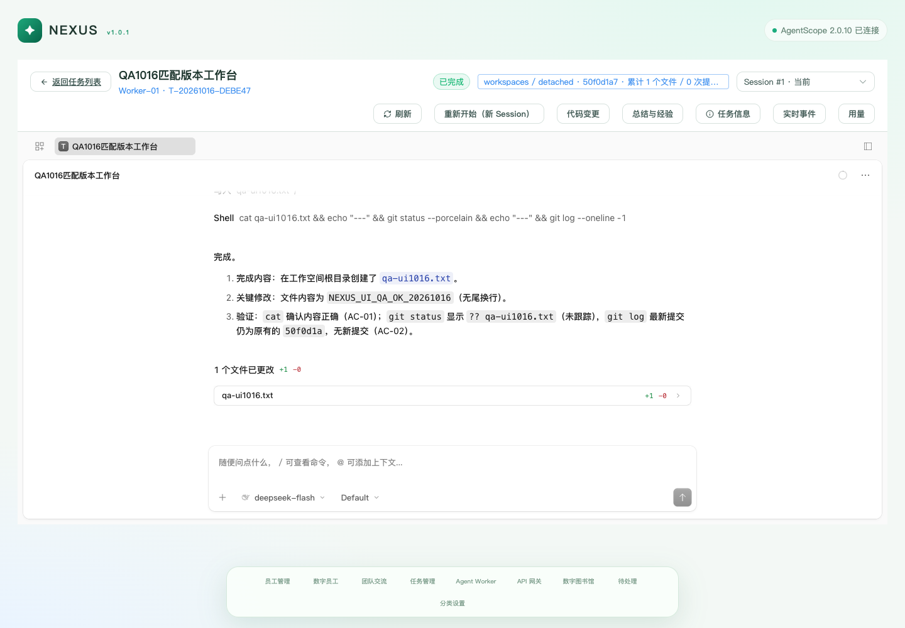

# Nexus 本地环境、功能测试与代码审查反馈

日期：2026-10-16（Asia/Shanghai）。审查与验证：Codex。业务缺陷留给 Claude 开发解决。

## 基线与结论

- 仓库：`git@github.com:linmumuxx-ux/Astra.git`
- 分支：`cursor/nexus-v1-0-1-phase2-f6f2`
- 最终审查提交：`ac812aab3b9d2a4ba0d45c957ef852e95cc81ad8`。先验证 `f2a1ead`，检查期间同步 `ac812aa`，重启 Task 平台并补跑最新代码的完整后端检查、针对性检查和前端构建。
- **本机基本功能可试用，不能据此判定整个产品通过验收。** 已跑通真实员工交流、Task MCP、OpenCode 文件交付和人工确认后的员工唤醒；存在下列 10 项明确问题。
- 没有修改、提交或推送业务代码。新增本报告和验证证据；本地环境、数据库和测试 fixture 位于忽略目录。原 `rewrite/astra-1.0` 的现场仍保存在 `stash@{0}`，标签 `codex-before-nexus-v1.0.1-deploy-20261016`，未恢复或删除。

## 本机环境与试用入口

- 页面：<http://127.0.0.1:5174/employees>，当前 Nexus 页面使用匿名浏览器标识，无需之前 1.0 预览版的 Bearer 登录凭据。
- AgentScope：`127.0.0.1:8000`，官方 `2.0.10`，独立进程，真实 Redis storage/message bus。
- Task API：`127.0.0.1:8100`；Gateway：`127.0.0.1:8110`；Nexus API：`127.0.0.1:8120`。
- Library MCP：`127.0.0.1:8201`；Task MCP：`127.0.0.1:8202`。
- Python `3.14.3`，Node `25.4.0`；macOS 本地开发验证，未验证 Linux 发布和 Python 3.12/Node 22 的全新安装。
- 配置保存到 `ops/env/.env`（0600），凭据没有写进报告、证据或 Git。AgentScope 已登记 DeepSeek 聊天配置，模型为 `deepseek-flash`。
- 新路径的 Task 与 Nexus SQLite 来自各自旧路径的独立备份/复制。没有把 Task 历史行写进 Nexus SQLite。迁移确认当前 head 为 `0036_experience_space_and_key_last_used`。
- Worker `astra-01` 配置为独立 fixture Git 仓库 `.astra/qa-20261016/workspaces`；最终固定 OpenCode `1.18.33`（`.astra/qa-20261016/runtime/node_modules/.bin/opencode`），独立端口 `14197`，模型 `deepseek/deepseek-flash`。原配置的备份保存在 `.astra/qa-20261016/worker-config-before.json`。
- 本机 Task 平台可用 `ops/dev/start_astra.sh status|restart|stop` 管理。shell `start` 存在 QA-08；Agent Service/Nexus API 当前使用 Python `Popen(start_new_session=True)` 启动，PID/命令记录在 `.astra/qa-20261016/processes.json`，日志在同目录。不要将该临时本机启动方式当成已修复的正式安装脚本。
- 依赖复用了本机已有虚拟环境，旧目录留下的未跟踪依赖/构建目录未删除。旧 1.0 预览服务已停止，邻接 `/Users/niuniu/程序/Nexus` 的服务未替换。

## 验证结果

| 范围 | 实际结果 | 证据 |
|---|---|---|
| 最新 Task 平台测试 | **508 passed, 4 skipped, 1 deselected**；显式 `ASTRA_ASSISTANT_ENABLED=true`，排除本机 DNS 环境不成立的一项 | [task-tests-latest-full.log](evidence/nexus-local-qa-20261016/task-tests-latest-full.log) |
| 最新变更及 Task MCP/outbox 针对性检查 | 18 passed | [latest-regression.log](evidence/nexus-local-qa-20261016/latest-regression.log) |
| Nexus API 基础检查 | 40 passed，4 个真实联调用例默认跳过，随后单独运行通过 | [nexus-tests.log](evidence/nexus-local-qa-20261016/nexus-tests.log) |
| 真实 AgentScope + DeepSeek 联调 | **4 passed**：员工管理、私聊/SSE、团队交流、`contact_employee` 对等唤醒 | [nexus-live.log](evidence/nexus-local-qa-20261016/nexus-live.log) |
| Task 平台 Ruff | 通过 | [task-lint.log](evidence/nexus-local-qa-20261016/task-lint.log) |
| 扩展到 Nexus API 的 Ruff | 1 项 E501，见 QA-10 | [lint.log](evidence/nexus-local-qa-20261016/lint.log) |
| 最新前端类型检查和生产构建 | 通过；约 2 MB 单一 JS chunk 的体积警告，未做性能量化 | [web-build-final.log](evidence/nexus-local-qa-20261016/web-build-final.log) |
| 创建任务草稿状态测试 | Node test runner：3 passed | `web/nexus/tests/task-draft-dirty.test.ts` |
| 浏览器入口 | 13 个路由实际打开，无 JS pageerror、无观察到的 API 4xx/5xx；随后深入操作发现 QA-04/07，说明页面能打开不等于功能完整 | 本机 `.astra/qa-20261016/browser-smoke.json` |
| OpenSpec 静态格式校验 | `validate nexus-v1-0-1-phase2 --strict` 通过，仅证明文档格式 | [spec-validate.log](evidence/nexus-local-qa-20261016/spec-validate.log) |
| 图书馆本地业务 | 创建两个空间、创建草稿、移动归档、删除草稿及空空间均通过，临时数据已清理；未发布到外部 llm_wiki | [extra-live-results.json](evidence/nexus-local-qa-20261016/extra-live-results.json) |
| Gateway + 真实上游 | 新建临时 Key，加载后 models/chat 200，真实回复 `QA_GATEWAY_OK`，最近使用时间落库；撤销后 401，删除 204，临时 Key 已清理 | [gateway-final.json](evidence/nexus-local-qa-20261016/gateway-final.json) |

测试环境说明：首轮后端 4 项失败中，3 项来自本次本机配置关闭了旧平台助手；显式开启测试配置后均通过，不列为产品缺陷。剩余 DNS 用例预期 `.invalid` 不能解析，但本机网络将 `astra-no-such-host.invalid` 解析到 `198.18.0.53` 且 TCP 可达，重复失败。最新完整检查显式 deselect 该项，没有更改测试断言来掩盖它。后端 4 个 skip 为两项真实 Redis Lua 检查及两项既有真实 OpenCode 场景；本次另做真实 OpenCode 冒烟不能替代这些原场景。

Gateway 新 Key 首次请求有约 4.1 秒配置加载等待，前 4 次 401 后变为 200；最终结果是等待周期加载后的验证，没有把刚创建立即 401 误判成永久不可用。

## 真实工程链路证据

1. `验收工程师1016` 在 AgentScope 私聊中实际加载 Task Skill，调用 `nexus_task_create`、`nexus_task_get`；仅创建一条 `T-20261016-39F2BE`，责任员工与来源 Session/Conversation 均已保存。
2. 员工实际调用 `nexus_task_start`。最初遇到旧 Serve 的工作区冲突；本地改用独立端口后启动成功。OpenCode `1.18.35` 在独立 worktree 创建 `qa-1016.txt`，内容 `NEXUS_QA_OK_20261016`。Codex 读取真实文件、比较 fixture 与 worktree HEAD，确认未新增提交。
3. 人工确认 API 返回 200，Task/Runtime 状态均为 `SUCCEEDED`；outbox 状态 `delivered`、attempts=0。责任员工收到真实提示后实际查询 task/logs/result，返回完成状态，没有二次改状态。
4. 这个 Session 暴露 QA-04。随后安装并固定匹配的 `1.18.33`，创建第二条 `T-20261016-DEBE47`，交付 `qa-ui1016.txt`、内容 `NEXUS_UI_QA_OK_20261016`，HEAD 未改变，人工确认完成。
5. 在真实 Chromium 中打开第二条任务，iframe title 为 **Task Workspace**，出现原生执行消息、Shell 结果与文件改动，无 pageerror，截图见下。

证据：[首条工程与确认](evidence/nexus-local-qa-20261016/task-final-proof.json)、[实际员工唤醒回复](evidence/nexus-local-qa-20261016/extra-live-results.json)、[匹配版本验收](evidence/nexus-local-qa-20261016/ui-task-proof.json)、[原生工作台浏览器状态](evidence/nexus-local-qa-20261016/workspace-browser-proof.json)。



## 交给 Claude 的明确问题

### QA-01 / P1：Task MCP 没有校验可信调用身份和任务归属

**位置：** `services/task-platform/app/task_mcp.py:22`，`app/task_tools.py:106-111`、`:311-312`。

**复现：** 对真实 `8202/mcp` 调用 `nexus_task_get`，不带身份头，或传入不存在的员工/Session，均 HTTP 200、`ok=true`，返回其他责任员工的任务。独立临时数据库中，以 employee-B 上下文调用 employee-A 的 `get/update` 也成功，标题被修改；无身份调用 `list` 返回全部任务。

**原因/影响：** 中间件直接信任请求头，`_optional` 只按主键读取；`list` 缺失身份时不加归属条件。模型之外的调用者或错误 Session 绑定均可突破“当前员工自己的任务”边界；修改/终止等工具复用同一路径。

**修复验收：** 缺失、伪造、员工与 Session 不匹配的身份必须拒绝；逐项覆盖 get/list/update/control/log/result/summary 的归属检查，保留合法员工操作自己任务。不能仅在提示词里限制。

**证据：** [真实 MCP 请求结果](evidence/nexus-local-qa-20261016/mcp-identity-probe.json)、[隔离数据复现](evidence/nexus-local-qa-20261016/domain-probes.json)。

### QA-02 / P1：取消任务技能后，已有会话仍保留全部任务工具

**位置：** `services/nexus-api/nexus_api/task_skill.py:38-39`，`main.py:910-951`。

**复现：** 员工选择 `task-management` 后保存，真实邮箱 Session 有 `nexus-task` 和 15 个任务工具。取消技能保存，API 返回 `saved_skills=[]`、`agentscope.ok=true`，但 AgentScope `/workspace/mcp` 仍有相同的 15 个工具，`/workspace/skill` 仍有“任务管理”。

**原因/影响：** 只有添加路径；技能未选择时直接 return，不撤回已有会话/Agent 工作区配置。UI 保存结果与真实可调用能力不一致。

**修复验收：** 取消配置后，邮箱、既有私聊和团队 Session 的相关工具/技能按明确契约撤销；重新选择可恢复。补真实 AgentScope 回归，不能只测员工 SQLite 字段。

**证据：** [取消前后真实工具清单](evidence/nexus-local-qa-20261016/skill-revoke-proof.json)。

### QA-03 / P1：任务唤醒重试 30 次后永久失效

**位置：** `services/task-platform/app/runtime/task_wakeup.py:12`、`:57`、`:71-74`。

**复现：** 临时 SQLite 的 pending outbox 设置 attempts=29，模拟一次短暂连接失败后变为 `failed`、attempts=30；恢复 sender 并再次执行投递，发送次数为 0。

**原因/影响：** 发送器只扫描 pending；达到上限后没有自动恢复入口。默认重试间隔 5 秒，持续离线约数分钟就可能把已记录但未被 inbox 接受的提示永久留下。与本分支 Spec 的“直到接受或被更新提示 supersede”不一致。

**修复验收：** 超出阈值的暂时故障仍可退避恢复；服务恢复或进程重启后未确认的提示最终投递。可观测永久错误要与暂时断连区分，不要靠新增事件页面补偿。

**证据：** [outage_recovery](evidence/nexus-local-qa-20261016/domain-probes.json)。

### QA-04 / P1：未打包的 Runtime 版本让工作台递归加载 Nexus

**位置：** `services/task-platform/app/api/workspace_routes.py:84-89`，`ops/dev/astra_service.py:216-237`，`web/nexus/src/views/TaskDetailView.vue:286-291`。

**复现：** 本机默认 `opencode` 为 `1.18.35`，任务实际能启动并交付，API 返回 `/opencode-workspace/1.18.35/index.html`。仓库只打包 `1.18.31/1.18.33/1.2.27`，Vite 对不存在路径回退 Nexus `index.html`，HTTP 200；任务 iframe 里再次出现 Nexus 顶栏与底部导航，读不到原生执行会话。

**原因/影响：** 启动预检只查默认与 UPSTREAM 两个包，运行时 UI 路由只做版本字符串校验，未确认实际 Runtime 对应资源存在。响应 200 和页面无 JS 异常会掩盖工作台不可用。

**本机处置：** 仅将本地 Worker 固定到已打包的 `1.18.33` 并独立安装，已验证原生页面正常；未修改业务源码，也未篡改旧 Session 的版本快照。

**修复验收：** 缺少实际版本的资源时，连接/启动或工作台明确拒绝并给出原因，不可静默 SPA fallback；匹配版本工作台可打开，历史 Session 按自身版本读取，不伪装版本或随意用其他包兜底。

**证据：** [版本与响应](evidence/nexus-local-qa-20261016/missing-workspace-ui.json)、[错误页面截图](evidence/nexus-local-qa-20261016/task-final.png)、[匹配版本成功截图](evidence/nexus-local-qa-20261016/task-matching-runtime.png)。

### QA-05 / P2：已禁用员工仍被任务唤醒启动新推理

**位置：** `services/nexus-api/nexus_api/main.py:849-868`，`services/agent-service/agent_service.py:148-160`。

**复现：** 将真实验收员工 `enabled=false`；`/api/v1/internal/wake-target` 仍返回邮箱目标 200。按 outbox sender 的同一路径向 `/nexus/task-hint` 投递测试提示返回 200，真实 AgentScope 产生新的 assistant 回复 `QA_DISABLED_RUN`。验证后已重新启用该员工。

**原因/影响：** 私聊和同事联系路径会检查 enabled，任务提示目标解析不检查；暂停员工后仍可能消耗模型额度并继续任务相关动作。

**修复验收：** 禁用期间不发起新推理；未投递提示如何保留、重新启用后如何恢复需与 QA-03 的可靠投递契约一致，不能直接标记丢弃或无限重试消耗。

**证据：** [disabled_employee](evidence/nexus-local-qa-20261016/extra-live-results.json)。

### QA-06 / P2：Runtime 异常被 MCP 遮蔽成泛化错误

**位置：** `services/task-platform/app/task_tools.py:299-308`。

**复现：** 启动 Task 时，旧 Serve 的启动工作区与当前 Worker 配置不同，Runtime 抛出 `OpenCodeServerUnavailable`，后台有明确的端口/工作区冲突信息。真实员工两次调用只拿到 `Error executing tool nexus_task_start`，而不是约定的 `ok=false` + 可操作原因，因而只能盲目重试或猜测 Worker 不在线。

**原因/影响：** `_runtime` 仅捕获 RuntimeStateError/InvalidTransition/ValueError，未处理 Runtime/SSH/网络相关异常；MCP SDK 将未捕获异常转换为 UnexpectedToolError。

**修复验收：** 在不泄漏凭据的前提下，已知 Runtime 故障返回结构化失败、真实状态与明确原因。覆盖不可达、端口/工作区冲突、超时；不能靠伪成功或重复提交 prompt 恢复。

**证据：** `evidence/nexus-local-qa-20261016/runtime-error-proof.json`；本机 `.astra/logs/task-mcp.log` 保留原始异常链。

### QA-07 / P2：底部导航遮挡聊天发送按钮

**位置：** `web/nexus/src/styles.css:80`、`:99-105`。

**复现：** Chromium 1440×1000 打开 `/chat`，发送按钮矩形为 x=1016、y=886、58×32；其中心 `elementFromPoint` 命中 NAV `.dock`。固定导航与聊天编辑器重叠，页面不能可靠点击发送。最新 `ac812aa` 上再次复现。

**修复验收：** 聊天和团队编辑器为导航真实高度预留空间；在常见桌面尺寸及导航换行时，输入、附件、发送均可点击；使用真实坐标命中检查，不只测组件存在。当前可用 Enter 键发送作为临时试用方式。

**证据：** [坐标命中](evidence/nexus-local-qa-20261016/nav-overlap-final.json)、[聊天截图](evidence/nexus-local-qa-20261016/chat-final.png)。

### QA-08 / P2：本地启动脚本依赖缺失的 setsid，并报出假启动成功

**位置：** `ops/dev/start_agent_service.sh:29-31`、`start_nexus_api.sh:33-35`、`start_astra.sh:25-26`。

**复现：** macOS 执行 README 的 start 命令，日志为 `setsid: command not found`；脚本仍打印 starting，Agent/Nexus 脚本写入 PID，服务没有监听。

**原因/影响：** 后台启动让 shell 不能可靠传回子进程失败，且没有启动就绪检查。本机首次配置不能照 README 完成。

**本机处置：** 使用独立 Python 进程启动；本条原始脚本未修复。Linux 部署尚未复验，不能将 macOS 失败泛化为所有 Linux 环境失败。

**修复验收：** 明确支持的本地平台与依赖；缺少依赖应同步非零退出并不保存无效 PID。支持的平台上必须确认真实健康后报告成功；停止操作校验进程身份，避免误杀复用 PID。

### QA-09 / P2：Worker 连接检测显示 AVAILABLE，但实际启动必然工作区冲突

**位置：** `services/task-platform/app/runtime/environment.py:154-159`，对照 `app/executors/opencode_local_server.py:92-97`。

**复现：** `14096` 上运行一个健康旧 Serve，目录与新 Worker workspace 不同。所有本地命令与目录检查通过后，`POST /api/employees/astra-01/environment/test` 返回 AVAILABLE；真实启动则报“Serve 的启动 Workspace 与员工配置不一致”。

**原因/影响：** 连接测试仅检查 `/global/health`，执行入口还验证 `/path` 和所有者；UI 绿灯不能说明配置实际可启动。本机改用独立端口后成功，不代表检测逻辑已修好。

**修复验收：** 健康但属于另一员工/工作区的端口应在连接检测明确失败；避免检测阶段写入或接管别人的 Serve。

### QA-10 / P3：Nexus API 静态检查有 E501，CI 未覆盖此范围

**位置：** `services/nexus-api/nexus_api/main.py:636`，`.github/workflows/ci.yml` 的 nexus-api job。

**复现：** 按该服务 pyproject 的 Ruff 规则检查，函数签名 112 字符超出 110。Task 平台 Ruff 通过；Nexus CI 当前只运行 pytest，未运行本服务 lint。

**修复验收：** 修正该行并将实际采用的静态检查纳入对应服务的 CI。此项不阻塞本机功能试用。

## 另外记录的风险与未验证范围

- outbox 并发：两个独立 AsyncSession 同时执行 `deliver_pending`，已在独立 SQLite 复现同一 row 发送两次。扫描没有领取/租约/条件更新；发送的 HTTP 请求不携带可供下游防重的 event id。默认单个 solo worker 下未复现实际重复副作用；**已验证的是重复发送，未验证的是生产多实例的重复业务动作**。Spec 允许重复投递但要求不重复改变任务状态，Claude 需覆盖并发与“接受后、落库前进程退出”的回归，不能仅靠 event_id 唯一索引宣称下游防重。
- 实际 Task 启动后 status=RUNNING，`current_progress` 曾仍为“已分配给 Astra-01，等待启动”；该矛盾已出现在真实员工回复中，人工确认后文案恢复。建议复核状态与展示字段的单一事实源。
- 平台助手在本机预览配置中关闭，因此自动任务总结/候选经验生成**未做真实模型验收**。相关模拟测试通过不能替代该验收。
- AgentScope Knowledge Base 按当前设计关闭，503 属于已知限制。本地数字图书馆业务与它是不同能力。
- llm_wiki 远端发布/同步、远程 Linux Worker 部署/重启、真实中断/断线/恢复/重试、全部权限提问场景、MySQL、多实例、全新离线部署未在本轮实测。没有将历史报告结果计为本轮通过。
- 匿名 `X-Owner-ID`/AgentScope `X-User-ID` 为现有占位身份，未据此声称达到对外发布的认证强度；QA-01 是在此基础上额外缺失的任务员工边界。

## Claude 接手建议

先处理 QA-01/02/03/04，再处理 QA-05/06/07/08/09，最后 QA-10。每项以本报告的复现和验收条件为准；先检查是否存在更晚提交，避免重复修复。保持当前产品/服务边界，不重新实现 Task 状态机或 AgentScope 会话，不把环境处置误当成业务修复。

隔离复现命令（不修改运行中的业务数据库）：

```bash
services/task-platform/.venv/bin/python docs/reports/evidence/nexus-local-qa-20261016/domain_probes.py
```

真实功能复验使用仓库现有测试；涉及模型的检查须显式运行并记录实际输出。两条成功的 QA Task 和验收员工保留供本机查看；临时 Gateway Key 与图书馆草稿/空间已清理。
