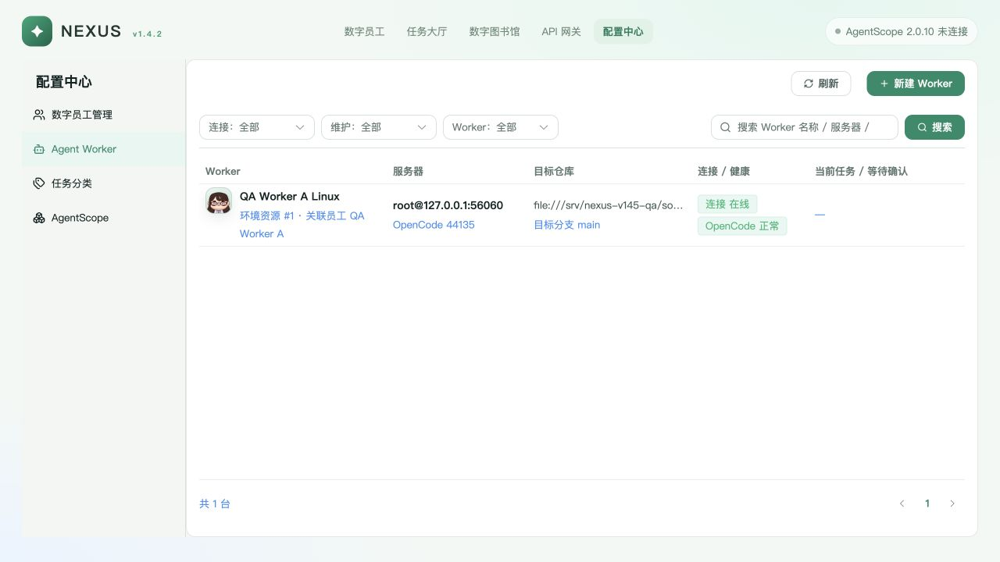
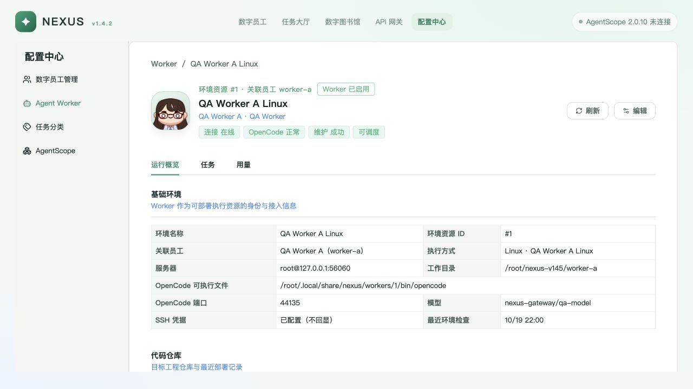

# Nexus v1.4.5 Worker 维护最终闭环复检（2026-10-19）

> 本报告只记录本轮重跑与可核验证据。早前双架构报告是历史快照，不等于当前源码在 x86_64 上重新 PASS。当前重跑范围是隔离 Linux aarch64、真实 QA Worker A、MySQL 未跑；Web 在会话前段已真实重跑，最终冻结阶段仅确认源码 hash 未变。

## 1. 结论

| 项目 | 本轮结果 |
| --- | --- |
| 本轮代码缺陷修复 | A-G 与 4 项审查问题已修复 |
| Linux 定向回归（22 文件） | **503 passed / 0 failed / 1 skipped**，pytest exit 0 |
| 唯一 skip | MySQL-only 方言用例，未提供 `ASTRA_TEST_MYSQL_URL` |
| ruff | `All checks passed!` |
| 源码漂移 | 清理生成缓存后 manifest 前后一致：`13917201…62000` |
| 真实原子写（SSH/SFTP） | PASS；旧文件进 600 备份，临时文件严格读取失败不覆盖 |
| QA API 重启 | PASS；仅重启隔离 QA API，PID/监听身份核验通过 |
| 真实 deploy / 同配置 redeploy | PASS；两次 `SUCCEEDED`，6 项装备 verified，PID/token/config/unit/worktree 不变 |
| 敏感值回显检查 | `match_count=0`（仅检查 API 响应，不代表历史上游工具无泄露） |
| x86_64 本轮 | **未复跑**，不能宣称当前代码双架构 PASS |
| Web 本会话 | 前段已跑 npm test 15/15、type-check、build 4019 modules；最终冻结阶段源码 hash 未变，未再次运行 |

## 2. 本轮代码修复

1. **同 owner 过期租约恢复**：`run_maintenance_once` 每轮先恢复所有已过期租约，避免续租失败且 `finish` 因过期拒写后操作永久 RUNNING；fencing 保留。
2. **reconcile 使用完整探测与独立 native idle**：保留安装锁/晚到指令核对，使用 `observe_environment(persist=False)` 写真实 projection；独立读取 `/session/status` 并调用 `RemoteProvisioner._assert_native_idle`。busy 不恢复 `AVAILABLE`，unknown/malformed 写 `UNKNOWN`，不再仅凭 `/global/health` 推断 idle。
3. **晚到 Worker 控制指令保护**：除 `maint:` 关联命令外，检查同环境未终态 `restart_opencode` / `switch_channel`；存在则保留 `INTERRUPTED` 锁，不靠时间猜测状态。
4. **Git installer askpass**：`remote_install.sh` 只把 0600 临时 token 文件路径写入 askpass，子进程不携带 PAT 值；真实 HTTP Git clone 通过。
5. **系统目录权限**：`/etc/nexus` 仍为 700；`/etc/systemd/system` 已存在时不 chmod，缺失时才创建 755。旧安装遗留的 QA VM `/etc/systemd/system=700 root:root` 已由独立 OpenCode 在确认普通目录、非 symlink、root 所有、700 后一次性恢复 755；仅修该隔离 VM，QA OpenCode PID 40203 与 Worker PID 40204 前后不变，证据见 `docs/reports/evidence/nexus-v145-worker-recheck/systemd-directory-oneoff-20261019.json`。代码不增加长期兼容逻辑。
6. **原子写严格读取**：目标文件读取异常立即停止，不再把读取错误当“文件不存在”；旧备份强制 600。
7. **内部 switch_channel 不重放**：六个公开维护动作之外的 retry 被拒绝，执行器也不会落入离线 restart；`reconcile` 释放锁路径保留。
8. **事件末页游标**：不足一页或空页返回 `next_cursor=null`，整页仍返回末条 ID。
9. **执行通道与版本事实**：restart/check 在真实路由选择后经 lease fencing 写 `execution_channel/reason`；`update` 记录 installer 返回的 `remote_commit`；after snapshot 的版本/模型/仓库只取 installer meta 或真实 probe，未知写 `null`。
10. **Skill 实际 revision**：只对绑定 Skill 集合计算语义 content revision；额外未管理 Skill 保留但不参与版本聚合，绑定内容缺失/未知时 `actual=null`。deployed/verified 语义不变。
11. **Node 探测路径**：`_probe_gateway` 使用每环境绝对 Node 路径，不依赖首次部署时的全局 `node`；补充 3 个真实子进程测试。

## 3. Linux 隔离回归

- 前置：`prepare_regression.py --reuse-venv --skip-install`，仅刷新 `/opt/nexus-v145-regression/src`；未覆盖业务 QA app。
- 源码 manifest：`139172014664b9e48da670e7e2bca2d0ca81752fa0247ad789c0a65051e62000`，272 个源码文件。
- 测试范围：final5 的 21 个文件 + 本轮 `tests/test_fix_b3.py`。
- Redis：仅原 harness 自有 61267 / DB14，PING 成功；未使用业务 DB1，未启动新 Redis。
- 结果：**503 passed, 1 skipped, 4 warnings in 92.32s**；pytest exit 0。
- ruff：`ruff check --no-cache app tests`，exit 0。
- 运行后排除 `.pytest_cache` / `__pycache__` / `.ruff_cache` 重新计算源码 manifest，与运行前一致。
- 宿主与 guest 的 `app/tests` 逐文件 hash 对比：各 218 文件，changed/missing/added = **0**，diff 行数 0。
- 本次新增：3 个 Node 绝对路径子进程测试 + 1 个「绑定 Skill + 额外未管理 Skill」revision 回归。
- 早前 499 运行使用旧 guest snapshot（缺上述 4 项测试），仅保留为历史，不作为当前结论。
- macOS 上 `test_install_script_rejects_python_below_3_11` 与 `test_install_script_installs_venv_package_for_the_selected_python` 两项均因安装脚本先执行 `只支持 Linux` 提前退出，不是测试逻辑失败；两项已在 Linux 回归真实通过。

证据：`docs/reports/evidence/nexus-v145-worker-recheck-20261019/`。

## 4. 真实 QA 部署与幂等

- 部署前 canonical health：`connection=online`、`schedulable=true`、`blocking=[]`、维护状态为已结束，满足无占用/无活动维护条件。
- 仅运行 `harness/restart_api.py` 重启隔离 QA API，加载当前源码；旧/新 PID 与监听归属核验通过。
- API 重启后 Worker 短暂离线；首次 `final_deploy.py` 只在 preflight 退出（未提交部署），等待 Worker 重新 online 后重跑。
- 重跑结果：两次同配置 deploy 均 `SUCCEEDED`，6 项装备全部 `deployed=true / verified=true`。
- 幂等：token/config/unit/worktree 哈希不变，OpenCode/Worker PID 不变，最新维护指针分别匹配两次操作。
- 敏感值回显检查：`secret_count=10`、`match_count=0`，仅代表本次 API 响应未命中所检查的脱敏值。
- 本轮仅重启 QA API 加载 controller Skill revision 修复；未重复部署 Worker。重启后 health：`schedulable=true`、`blocking=[]`、Skill `desired=actual=2be29b84c89b6f90`、`verified=true`、`diff=[]`。
- Codex 已通过 CUA 独立浏览当前真实列表与详情：Worker 在线、OpenCode 正常、最近维护成功、可调度，Skill 目标/实际同为 `2be29b84c89b6f90`。列表截图见 `docs/reports/evidence/nexus-v145-worker-recheck/ui-worker-list-current.png`，详情截图见 `docs/reports/evidence/nexus-v145-worker-recheck/ui-worker-detail-current.png`。

## 5. Web 与真实页面

- 本会话前段已真实运行：npm test **15/15**、type-check 通过、build **4019 modules** 通过。
- 最终冻结阶段未再修改 Web 源码，因此没有重复运行上述检查；当前 `web/nexus/src` 树哈希：`a0a951ad228abdce21c2ee980f154e7c6928d86a3a8255bc6710c964ca15dcdd`。
- Codex 已通过 CUA 独立浏览当前真实列表与详情，确认 Worker 在线、OpenCode 正常、最近维护成功、可调度，Skill 目标/实际均为 `2be29b84c89b6f90`。
- 列表截图：`docs/reports/evidence/nexus-v145-worker-recheck/ui-worker-list-current.png`
- 详情截图：`docs/reports/evidence/nexus-v145-worker-recheck/ui-worker-detail-current.png`

## 6. 边界与未验证

- **x86_64 本轮未复跑**；早前 x86 证据属于历史快照。
- **MySQL 未跑**；唯一 skip 为 MySQL-only 编译用例。
- **非 root 独立部署不支持/未验收**：当前一键部署要求 root，代码没有 sudo 升权路径。
- **模型只验证认证与路由可见性，未调用真实推理**。
- 本轮未触碰其他主机、业务服务、业务 DB 或 x86 用户测试机。
- 本轮补正已本地提交，未 push、未 archive OpenSpec。
- **临时 QA 凭据需轮换；未更改生产凭据。** 此前 QA 工具曾误输出隔离环境临时密钥，本报告不复述该值，也不宣称全程零泄露。

## 7. 历史关系

早前报告 `NEXUS_V145_WORKER_MAINTENANCE_20261019.md` 保留为 final5 时点历史快照；其中“全 PASS”仅适用于当时快照与范围，不应无条件套用于当前源码。
