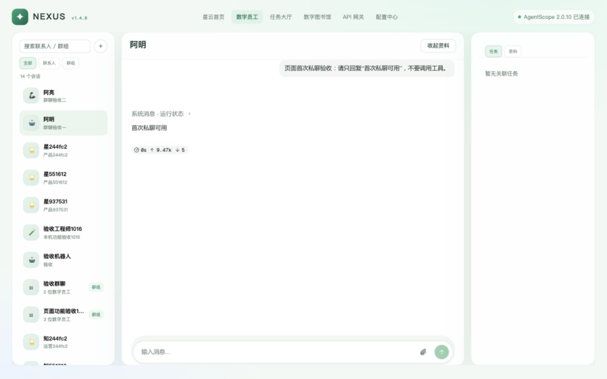
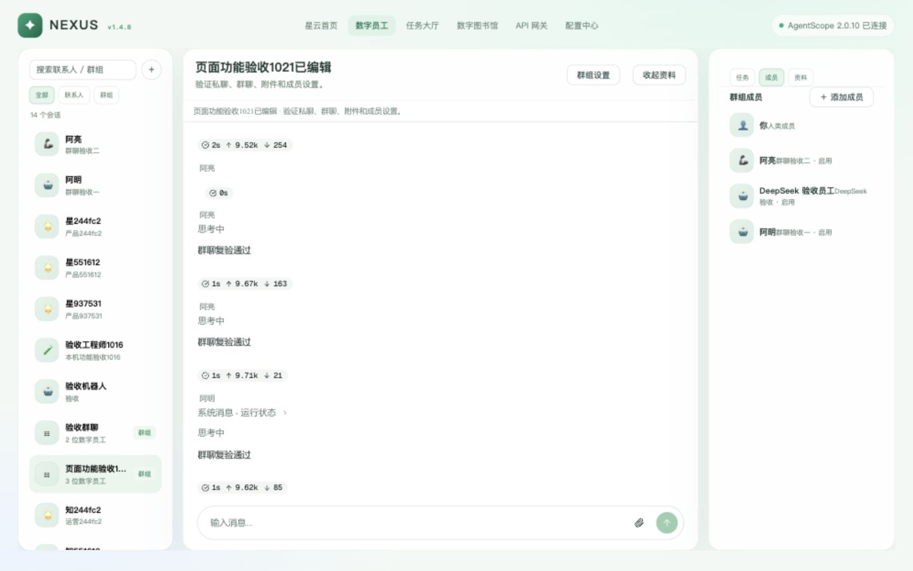

# 数字员工私聊与群聊页面审查及修复

审查日期：2026-10-21。基线：`v1.4.8` / `739d15efa`；修复分支：`codex/chat-capability-review`（已合入 `v1.4.8`，合并提交 `24ba8f519`）。
操作工具为 Codex 内置浏览器，桌面视口 1440×900。发送、附件上传、创建群组、成员添加和停止均从页面操作；API 只用于独立核对状态与绑定，不代替页面提交。

## 问题原因与处理

| 问题 | 本轮实际证据 | 处理 |
| --- | --- | --- |
| 空壳记忆 | [02-memory-before.jpg](evidence/chat-capability-20261021/02-memory-before.jpg) 显示会话编号，并在发送后继续显示尚未创建 | 移除记忆 Tab；不在 Nexus 另造记忆 |
| 未接入实时语音 | 空输入出现实时语音按钮，但没有处理回调 | 无处理回调时显示正常的空态发送按钮，不展示实时语音操作 |
| ASR 未就绪也可录音 | 初始 19899 没有服务，但仍出现麦克风 | 查询同源模型就绪接口，只有模型加载且浏览器能录音才显示 |
| 纯附件无法发送 | [04-attachment-only-before.jpg](evidence/chat-capability-20261021/04-attachment-only-before.jpg)：上传成功，空文字按 Enter 后没有提交 | 以文字或已完成附件作为可发送内容 |
| 切换丢失草稿和附件 | 群聊输入未发送文字，切换私聊再切回，输入清空 | conversation/channel 分键、标签会话存储，只保留未发送内容 |
| 群组设置与聊天岛不同步 | 外层成员更新，iframe URL 不变，旧标题和订阅仍在 | 保存成功后重新挂载当前聊天岛 |
| 移除成员丢失绑定 | 在新建验收群中移除阿明、再加入，原 Session 绑定和原回复不再可读 | 已有成员只读，保留新增成员、名称与目标编辑；移除不完整的成员移除操作 |
| 群聊排序与流式增长不跟随 | Nexus UTC 时间与 AgentScope 本地 ISO 时间按字符串比较；新流式回复插在旧回复前，DOM 有新内容但底部仍是旧回复 | 按 Date 时间值比较两种 ISO 时间；内容更新时仅在跟随模式滚底；向上阅读保持位置，提供回到最新消息按钮 |
| 首次对话失败 | 路由与节点接口 500，异常为 `HttpGatewayProbeClient.__init__()` 不接受 `timezone` | 删除该无效参数，保留控制服务本身的时区参数；增加不覆盖真实客户端的接口回归 |
| 打开失败缺少恢复入口 | 容器始终挂载空 conversation 参数的 iframe | 区分加载、准备失败与就绪；展示实际错误和重试 |

## 页面操作与结果

| 步骤 | 操作 | 结果与证据 |
| --- | --- | --- |
| 1 | 打开私聊、输入并按 Enter；停止后再次发送 | 通过。旧会话返回“私聊可用”；新建阿明私聊返回“首次私聊可用” |
| 2 | 私聊选择文本附件，文字留空后点击发送 | 通过。模型读出“薄荷星云”；纯附件在输入区可以发送 |
| 3 | 新建群组，先提交空表单，再选阿明、阿亮 | 通过。空表单提示必填；合法表单创建群组并进入会话 |
| 4 | 在群聊点名两位员工 | 通过。两位员工各自回复，发言人显示在气泡外；[06-group-two-replies.jpg](evidence/chat-capability-20261021/06-group-two-replies.jpg) |
| 5 | 群聊生成时停止；私聊生成时停止 | 通过。原生消息 `finished_reason=interrupted`，私聊 `is_running=false`；两份状态证据见本报告下方 |
| 6 | 群组改名、添加成员 | 通过。左栏、标题、聊天岛与成员面板同步；添加前已有 Session 绑定逐项保持相同 |
| 7 | 群聊草稿及附件 → 私聊编辑另一条草稿 → 切回 → 刷新 | 通过。草稿互不串入，群聊恢复文字与附件；[08-draft-restored.jpg](evidence/chat-capability-20261021/08-draft-restored.jpg) |
| 8 | 清空群聊文字，仅发送恢复的附件 | 通过。消息被记录；未点名时提示“@ 成员后才会收到回复”，不伪造员工响应 |
| 9 | 刷新群聊历史 | 通过。附件仍显示卡片。旧 API 进程此前只返回 text，更新进程后实际返回 text + data |
| 10 | 搜索不存在的会话、按阿亮搜索群组、清空并切回全部 | 通过。0 条时有空态；按成员能找到群组；清空恢复列表；[10-search-empty.jpg](evidence/chat-capability-20261021/10-search-empty.jpg) |
| 11 | 群聊向上滚动，再点击回到最新消息，发送新回复并复制 | 通过。时间排序正确、最新回复可见；复制结果包含最后的校验词；[13-stream-follow.jpg](evidence/chat-capability-20261021/13-stream-follow.jpg) |
| 12 | 用真实 18120 页面重验首次私聊、群聊新 Session | 通过。路由接口 200，阿明和阿亮均返回“群聊复验通过”；最终截图如下 |

流式截图中的检查项是员工回复内容，不作为这些检查项已通过的证明；本轮独立证据是最新内容在底部可见、回到底部按钮状态，以及剪贴板包含最新校验词。

原始核对：[群聊中断](evidence/chat-capability-20261021/group-stop-state.json)、[私聊中断与成员绑定](evidence/chat-capability-20261021/runtime-verification.json)、[最终页面 DOM](evidence/chat-capability-20261021/final-dom.txt)。

## 检查结果

- `chat-island`：类型检查、构建通过，10 项测试通过，包括新增的 3 项草稿隔离与恢复测试、2 项混合时间格式排序测试。
- `web`：类型检查、构建通过，24 项测试通过。
- `pytest tests/platform/test_gateway_control.py -q`：54 通过、1 跳过。跳过原因是本机 DNS 将 `.invalid` 域名解析为地址，无法执行“解析失败”的负向断言。
- 修改的两份 Python 文件 Ruff 通过；源码范围的 `git diff --check` 通过；生成的压缩 JS 内置模板有尾空白提示，保留构建器输出，未手改哈希资产；OpenSpec 严格校验通过。
- 构建仍有已有大包与 `mime-types` 的浏览器模块提示；没有将这些提示当作失败，也没有改动打包架构。
- 浏览器自动操作中有 Element Plus 隐藏 checkbox 的定位失败，以及第一次停止前回复已结束的时序失败。已改用可见标签及生成期间立即停止，随后复验成功；这些操作脚本失败没有作为产品缺陷报告。

### 合并回 v1.4.8

修复分支 `codex/chat-capability-review`（`c5c016f7a`）已于 2026-10-21 合入 `v1.4.8`，合并提交 `24ba8f519`。

- 冲突只出现在 `web/dist` 构建产物：CSS 重命名/重命名、JS 重命名/删除与删除/修改、`index.html`。按合并后源码重建 chat-island 与 web，未手改哈希资源；合并提交内为 `index-Cf6b1v8_.js` / `index-DyMMgybC.css`。
- `tests/platform/test_gateway_control.py` 自动合并，网关配置用例与探测客户端回归用例都保留。
- 合并提交只包含修复分支改动；合并期间本目录中并行的未提交改动未纳入，也未覆盖。
- 合并后复核：`test_gateway_control.py` 55 通过、1 跳过（主线在基线上新增 1 项网关用例，故比修复分支多 1 项）；`tests/nexus` 128 通过、4 跳过；`web` 24 项、`chat-island` 10 项测试通过；两套类型检查与构建、改动 Python 文件的 Ruff 通过。
- 全量 `tests/platform` 仍有 9 项环境性失败：5 项为 OpenCode 1.18.35 与本机期望版本 1.18.33 不符（`test_employee_serve.py` 4 项、`test_opencode_server.py` 1 项），2 项远程脚本在 macOS 返回“只支持 Linux”，2 项 phase4 依赖本机 OpenCode/环境；另在 `test_worker_agent_files.py` 被沙箱以 SIGSYS 终止。这些测试不在合并 diff 内，未作为合并失败处理。

## 本机运行与数据

初始 API PID 43752 来自原目录且运行旧代码，任务接口确认无 Task 占用。先通过受管脚本更新到原目录代码，独立复现路由 500；随后使用原进程管理记录加载本次隔离工作区的统一 `nexus_api.service:app`，PID 90817，端口仍为 18120。数据目录继续使用原有 `services/nexus-api/data`，没有另建业务数据库。原目录的源码和其他人的提交未覆盖。

初始网关 18110 未运行，库版本为 0054。已将本地 SQLite 做权限受限的完整备份，再仅执行已提交的 0055、0056 必要迁移，启动网关 PID 88979。没有执行原目录正在开发的其他迁移。备份位于 `/private/tmp/nexus-chat-capability-private/nexus-before-0056.db`，不入库、不展示内容。

独立 ASR 在离线模式下启动并确认模型 loaded=true，预览代理中出现转写按钮；未就绪或没有同源代理的 18120 页面不出现该按钮。真实麦克风录音没有申请设备权限。临时 ASR 和 15194 构建预览完成验证后停止，保留实际 18120 统一服务与必要网关。

本轮新增测试群组为“页面功能验收1021已编辑”（`ch_6dc64df73a0f`），以及普通无敏感内容的测试消息/附件；保留它们便于复查。成员移除问题仅在本轮新建群中复现，已有业务群成员没有更改。

## 剩余风险与未验证

- 原生 AgentScope 的无时区时间按上游 Date/浏览器本地时区解释；本轮服务和浏览器均为 Asia/Shanghai，异时区部署未验。
- 本机 18120 服务仍由修复工作区代码提供（PID 90817）。代码已合入 `v1.4.8`（`24ba8f519`），但尚未推送远端、未部署生产，也没有在重启加载合并后代码后再做浏览器复验。
- ASR 只验证就绪与入口展示；真实录音、图片和 PDF 理解、超大/异常附件、超长历史未在本轮验证。文本附件已真实验证，不代表这些类型通过。
- 会话列表/绑定失败重试已做代码核对，没有对运行中的统一服务做断网或鉴权故障注入；不能声称该 Scenario 已完成浏览器故障回验。
- 新按钮有可访问名称；完整键盘、读屏、对比度和手机布局未做专项验收，截图不能证明完整无障碍合规。
- 后端原成员移除 API 保持现状；本次只清理页面危险入口。未来若开放成员移除，需先设计保留绑定与历史的契约及迁移。
- 本轮是本机真实服务验收，未部署生产。OpenSpec change 保持可审阅状态，不归档为生产发布完成。
