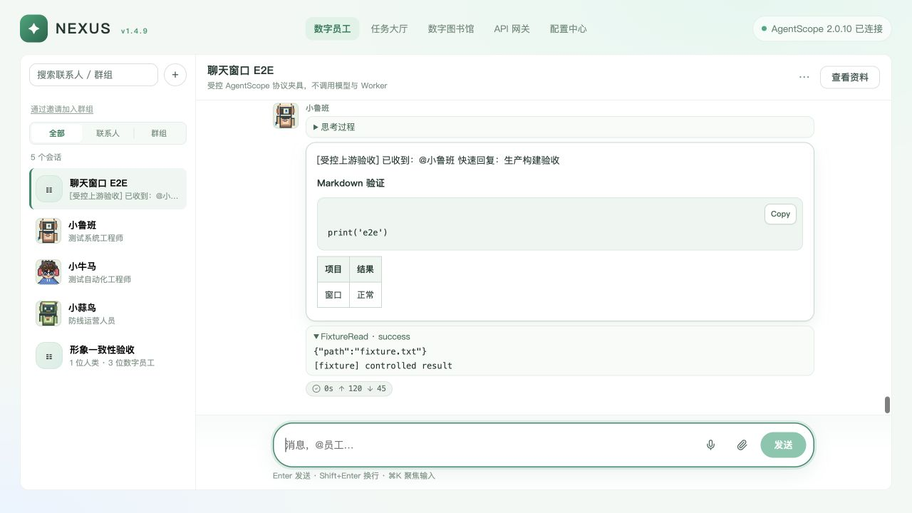
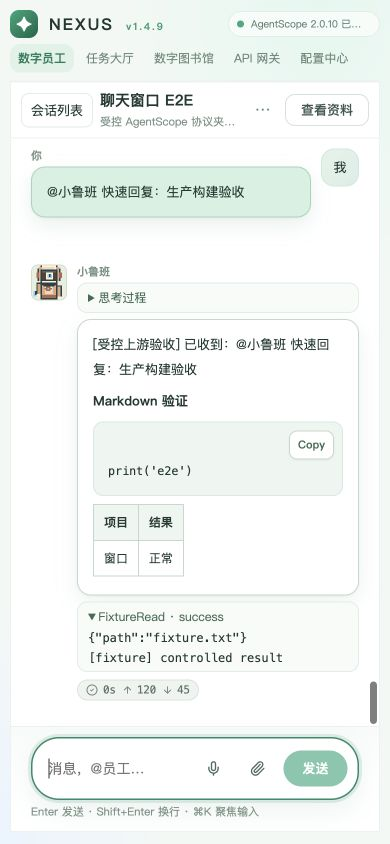

# 数字员工对话窗口重构审视与 E2E（2026-10-30）

候选重构存在会阻断群聊发送、丢失原生消息、伪造确认成功和残留连接的问题。已在独立集成分支修复；当前受控上游的浏览器验收通过。真实 AgentScope 不可达，本次不能作为真实模型、Worker 或生产部署验收。

## 版本与环境

- 审视分支：`codex/nexus-chat-window-e2e`。
- 首页基线：`9743a09cbb1fe4b891aaabd43c9436a255fa8ddc`（origin/v1.4.9）。
- 候选集成：`6402ef94c`（feat/v1.4.9-with-chat-native）；原聊天候选 `40bfc36a8`。
- 本次在新 worktree 集成，保留原候选 worktree 的未跟踪截图与其他工作。
- 本次未推送、合并远端 v1.4.9，未部署或重启原服务。
- 隔离 Nexus API：`127.0.0.1:18563`；同一进程托管最终 web/dist。
- 专用临时 SQLite：`/private/tmp/nexus-chat-window-e2e-20261030/office.db`，来源为办公室验收夹具的副本，不是业务库。
- 真实 Nexus 路由、归属检查、群讨论协调、数据库、上传和 SSE 均运行；只有 AgentScope 上游由 `httpx.MockTransport` 提供确定的原生协议响应。所有生成内容标记 `[受控上游验收]`，没有模型和 Worker 调用。

## 发现、原因与修复

| 严重度 | 已复现问题与原因 | 修复 |
|---|---|---|
| P1 | 群聊发送遗漏必填 client_id，返回 422；客户端依赖已不存在的 triggered 字段 | 对齐当前 canonical 响应；失败重试复用原 client_id |
| P1 | 群聊读取旧结构，并订阅不存在的成员流；系统和员工身份混淆 | 使用 messages / events 统一有序流及 sender envelope；分离 SSE 序号和 discussion id |
| P1 | 私聊使用扁平消息与手写事件解释，丢失 thinking/data/hint，工具结果开始即被误判完成 | 读取原生历史，复用既有 AgentScope SDK appendEvent；保留真实工具结果、输出、usage 和结束原因 |
| P1 | 允许、记住、拒绝按钮只修改本地工具状态，没有服务端确认请求 | 去掉伪确认；意外 asking 只读显示等待，原 dont_ask 权限策略保持不变 |
| P1 | 发送响应晚于结束事件时仍设置 streaming；普通群消息也会永久显示停止 | 以服务活动状态/结束事件更新；用事件版本防止迟到响应覆盖终态 |
| P1 | 停止失败后本地猜测状态，且定时器会自行宣布停止；错误提示在成功后残留 | 停止结果重读服务快照，等待真实终态；失败可重试，成功清理旧停止错误 |
| P1 | 切走不释放订阅；迟到的首次绑定会重新开启后台流；后台上传结果被丢弃 | suspend/resume 与代际检查；只订阅当前会话，上传仍归原会话；响应处理异常也取消 reader |
| P1 | Vue reactive 对象不能被 structuredClone，群聊流进入异常状态 | SDK 克隆前 toRaw；增加真实 reactive 对象回归 |
| P1 | 并发历史响应会擦掉较新的流式文本 | 保留服务重放游标，按游标合并原生消息；旧快照不覆盖更新的内容与活动状态 |
| P2 | 用户消息与快回复在同一毫秒内倒序 | 排序保留 ISO 时间的微秒精度；仍仅按 id 合并 |
| P2 | 聊天气泡显示头像 ID/群符号，同事回传也被归到当前员工 | 复用统一 EmployeeAvatar；使用 group sender_id 与 private peer_employee_id |
| P2 | 群聊丢失已读序号；异常提示无游标时被过滤 | 恢复 /read；上游错误提示不受重放游标过滤 |
| P2 | 桌面负底边距导致聚焦后外层滚动、标题裁切；窄屏长列表挤走输入区 | 去掉溢出边距；窄屏用会话/资料抽屉，保持输入区与标题在视口内 |

旧历史覆盖新文本的反例在修复前得到 `first`，预期 `first second`；修复后同一回归通过。日志见 [反例](evidence/nexus-chat-window-e2e-20261030/race-before-fix.txt)。

## 验证结果

| 检查 | 结果与范围 |
|---|---|
| web 单元回归 | 69 passed；候选原有 48 项未覆盖上述协议和生命周期问题，本次补齐 21 项行为回归 |
| Nexus 全套测试 tests/nexus | 170 passed，6 skipped；跳过项不计入通过 |
| 后端最终针对性回归 | test_api / test_chat_native / test_collaboration / test_groups：90 passed，包含 finished_at / usage 新断言 |
| 旧 chat-island 单元测试 | 17 passed |
| web / chat-island 类型与构建 | 两套 build 均先执行类型检查并成功；另完成 web type-check |
| Ruff | nexus_api、tests/nexus 和新验收工厂通过 |
| OpenSpec | nexus-chat-native-transport strict validate 通过；场景核对见同 change 的 verification.md |
| 浏览器 | 23 项操作通过；使用真实 Nexus API，受控 AgentScope 协议上游 |
| 最终构建控制台 | 新页面 error / warn 均为空，见 browser-console.json |
| 订阅释放 | 实际私聊上游流 1 → 切到群聊后 0；运行 Session 与挂起任务均 0，见 resource-state.json |
| 依赖 | 原有锁定包版本未改变；增加与旧聊天岛一致的 SDK 0.0.15 和测试运行器 tsx 4.20.6 |

两套构建仍有大 chunk 警告；本次没有做全站拆包。最终 web 构建在 chat-island 构建完成后生成，避免复制旧资源时的并发覆盖。

## 浏览器实际操作清单

1. 群聊普通消息发送，无员工触发时保持空闲。
2. 群聊 @ 员工：统一事件流完成后恢复发送按钮。
3. 私聊终态早于发送响应：不残留停止状态。
4. 私聊连续两轮回复、代码块和表格。
5. 停止失败保持执行状态及重试入口。
6. 重试停止后服务确认中断，恢复发送。
7. 发送失败保留草稿，点击重试成功且单份消息。
8. 私聊切换后草稿独立保留。
9. 意外 asking 只显示真实等待，不提供本地伪确认按钮。
10. 执行中切换会话、返回恢复权威运行态与新草稿、停止。
11. 刷新后原生历史恢复，已中断状态保留。
12. Markdown/PNG 真实 Nexus 上传成功并生成两个草稿附件。
13. 发送后 Markdown 正文预览和 PNG 图片展示。
14. 任务/资料侧栏可打开和切换。
15. 390×844：输入区始终可见，无横向页面溢出。
16. 手机会话抽屉可选员工，资料抽屉可关闭。
17. 群聊 55 条真实日志：加载较早分页后无重复。
18. 群聊两位员工依次回复并完成，原生工具/Markdown保留。
19. 群聊执行中可停止，滚动回看出现“最新”入口。
20. 群聊来源关联任务卡可进入原任务详情。
21. 工具错误保留 error 和具体失败输出。
22. 生产构建经同一 Nexus 服务托管，可发送并完成群聊回复。
23. 修复后用户消息先于同毫秒的快速回复。

详细结果见 [e2e-cases.json](evidence/nexus-chat-window-e2e-20261030/e2e-cases.json)。任务卡验收只验证来源关联和跳转，没有执行夹具任务或人工授权。

## 效果与证据

最终同服务构建：

390×844：

复现阶段证据：[群聊身份错误](evidence/nexus-chat-window-e2e-20261030/02-baseline-group-wrong-speakers.jpg)、[窄屏输入区不可见](evidence/nexus-chat-window-e2e-20261030/06-mobile-before.jpg)、[意外确认只读](evidence/nexus-chat-window-e2e-20261030/04-readonly-confirmation.jpg)。早期截图展示当时的缺陷，最终效果以 11、12 两张为准。

## 剩余边界

- 只读检查现有 `18120/api/v1/runtime` 得到 configured=true、reachable=false。真实 AgentScope 的模型推理、任务工具调用、断网重连和 Worker 最终释放没有完成实机验收。
- 麦克风录音、真实语音网关识别未验收；本次未采集麦克风数据。ASR 组件保留原入口与失败处理。
- 人工工具确认仍没有 Nexus 服务端处理通道；当前只读展示，不能视为已实现确认功能。
- 组成员撤销、重放及跨 owner 拒绝由针对性单元/后端测试覆盖；本次浏览器未穷举全部权限操作，也未验证手机软键盘与所有浏览器。
- 未运行远端 Linux、生产配置或压测。本次测试期间没有启动 Worker；夹具中已有的静态任务/Worker 展示不代表真实占用或释放证据。

## 复跑

在 Nexus API 的已安装依赖环境运行新工厂 `tools/e2e/nexus_chat_window_fixture.py`。先用既有 `tools/e2e/nexus_pixel_office_fixture.py --directory /tmp/nexus-chat-window-e2e-<unique> --employees 3` 建立全新的临时验收库，再设置 `NEXUS_CHAT_E2E=1`、该目录的 ASTRA_DATA_DIR / SQLite URL，以 uvicorn factory 启动。工厂拒绝普通数据目录。选用未占用端口，正常输入临时 UID，创建测试群。

受控触发词：快速回复、慢回复、失败一次、停止失败、工具失败、确认卡。夹具不接触真实厂商凭据，不执行工具与模型。命令行回归见项目 AGENTS.md 与本报告各测试路径。
