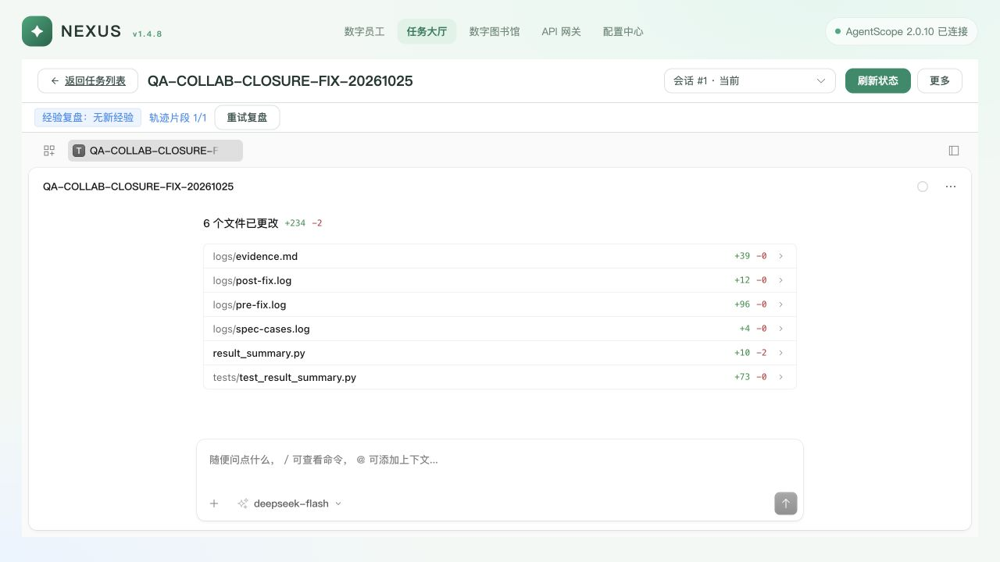

# 数字员工协作闭环修复与复验

日期：2026-10-25。文本证据已脱敏并规范化行尾空白，截图与结构化工具结果保留。结论：已修复本轮有反例的协作、任务回传、总结工具与工作区恢复问题；真实 QA 闭环通过。Worker 自然断线的网络/通道根因仍未定位，不能据此宣称长期无人值守或公司生产验收通过。

## 分支与运行范围

- 初始基线：`821793ced6584e1eb38b710ca27c71c682754e23`；收尾时发现主目录新增移除知识使用分析的提交，已在隔离分支快进同步到 `a3aeb28d050a33b54fa5893bd7a4a744a21dd638` 并重新运行 Web 测试/类型检查/构建。原目录 `v1.4.8` 未覆盖。
- 修复分支：`codex/collaboration-closure-fixes`。
- 修复目录：`/Users/niuniu/.codex/worktrees/collaboration-closure-fixes/Astra`。本文记录验收时的隔离分支状态；后续提交、合入和推送以 Git 记录为准。
- 测试入口：`http://127.0.0.1:18520`；Agent Service 18500、Task MCP 18502；沿用真实网关、Library MCP 与 Lima Linux Worker 5。
- QA 的 API、Agent Service、Task MCP、Celery Worker/Beat 已统一从修复目录运行。PID/create_time/cwd 及实际静态资源校验见 [final-audit.json](evidence/final-audit.json)。未更新其他 18641 栈。
- 本地业务库为 SQLite；执行器为 OpenCode 1.18.35，本轮不包含 DSH 链路验收，没有新增 schema，也没有进行 MySQL 生产部署验收。

## 原因与修改

| 已证实问题 | 修改与边界 |
|---|---|
| `contact_employee` 的群联系实际已经提交，但路由返回类型只允许字符串，`scheduled: true` 导致响应校验 500，员工误判失败并重发 | 修正响应类型；完整 HTTP 集成反例证明旧行为失败、新行为成功且只投递一次 |
| 群工具预算只有 2 次，而且直接修改共享 Agent 记录；正常“技能→分类/仓库→建单”会被截断 | 仅对本次群装配深拷贝记录并设置有限预算 8；保留 6 轮、时间、Token 与工具权限限制；原记录不变 |
| 员工公开交付结果后，请求者不一定被唤醒；原群规则鼓励只公开称呼同事，回传动作不清楚 | 群规则明确：需要对方继续行动或结果交还时通过 `contact_employee` 投递，并交代回传对象和下一步；没有增加脚本化 Agent 内部编排 |
| 结束的群讨论不会把后续 Task inbox 提示变成群内可见交付 | 复用 Task/Event/Outbox，校验员工、来源群与 Session，在原群追加系统事实通知；稳定事件消息 ID 去重；提供“查看任务”；不冒充员工，不自动开启旧讨论、不借旧权限 |
| 技能声明了 `nexus_task_summary`，实际 MCP 未注册 | 注册只读工具，复用既有责任人/群/私聊归属检查，返回真实复盘 Job、所属候选状态与图书馆 URL；过滤无关任务候选和内部凭证 |
| SSE 重连只接收后续事件，丢失期间的历史与终态不补读；父页面会保留旧执行状态/错误提示 | 异常 EOF/读失败后的重新连接触发已绑定工作区恢复，主动 abort/cancel 不触发；已中断流的下一次重连若又被取消，保留待补读标记；父页订阅 Task/Runtime 事件及连接就绪，工作区真实绑定事实变化时再通知父页读取事实 |
| 工作区构建仍落到旧 `web/nexus/public`，服务实际读取 `services/nexus-api/web`，新恢复代码可能根本未部署 | 修正 Vite 和构建脚本的产物位置，重新构建工作区、聊天岛和最终 Web；实际服务返回的三个 HTML 与修复产物逐字节一致 |

## 自动化验证

| 检查 | 结果 | 证据 |
|---|---|---|
| 联系路由旧行为反例 | 原代码发生 `ResponseValidationError`；修复后通过 | [peer-before.txt](evidence/peer-before.txt)、[peer-after.txt](evidence/peer-after.txt) |
| 扩大后端回归 `tests/platform tests/nexus` | **1338 passed，33 skipped** | [backend-tests.txt](evidence/backend-tests.txt) |
| 最终相关后端回归 | **55 passed**，覆盖最后的归属收紧与群规则修改 | [backend-targeted-final.txt](evidence/backend-targeted-final.txt) |
| Ruff（app、nexus_api、tests、修改的 Agent Service 文件） | 通过 | [ruff-final.txt](evidence/ruff-final.txt) |
| Web / 聊天岛测试 | **30 / 17 passed** | [web-tests.txt](evidence/web-tests.txt)、[chat-tests.txt](evidence/chat-tests.txt) |
| Web、聊天岛、工作区类型检查与构建 | 均通过，最终 Web 包含最终工作区与聊天岛产物 | [web-build-final.txt](evidence/web-build-final.txt)、[chat-build.txt](evidence/chat-build.txt)、[workspace-build-final.txt](evidence/workspace-build-final.txt) |
| 异常 SSE / 主动 abort、cancel、非 SSE 隔离 | **3 passed** | [workspace-recovery-tests-final.txt](evidence/workspace-recovery-tests-final.txt) |
| OpenSpec strict / `git diff --check` | 通过 | [openspec-validation.txt](evidence/openspec-validation.txt) |
| 凭据和上下文扫描 | 修改产物与证据未发现实际私有环境凭据或未脱敏上下文 | [final-audit.json](evidence/final-audit.json) |

全量回归后又对通知归属和候选筛选作了收紧，因此补跑了最终 55 项相关回归；没有把先前全量结果说成最后每次编辑后都重跑。测试中存在依赖弃用和 SQLAlchemy 连接清理警告，33 项跳过不算通过。

## 真实端到端复验

场景：A 向 B 要反例，B 交还，A 建工程任务，真实 Linux Worker 检索已发布经验并修复汇总器；人类独立验收后确认，后台复盘，再由员工查真实总结。使用隔离 QA 仓库，不 push，不访问其他任务工作区。

1. 新群 `ch_6e8a2e0c5f73`，只含 A、B。A→B 联系成功；最初 B 只公开回复，仍需一次人工提醒交还。这个事实没有从报告中删掉。
2. B 通过真实工具交还后，A 完成 Skill、分类、仓库和创建调用，真实建出唯一任务 `T-20261025-C81270`，标题 `QA-COLLAB-CLOSURE-FIX-20261025`；不再因两步预算被截断。
3. Worker `qa-worker-experience-20261023` 在新 worktree 执行，OpenCode Session `ses_e8d82e125ffeX0AkG7A71PRuYt`。真实 `library_search` 命中，再通过 `library_get` 读取已发布知识 `KNOW_A394DEFC1CA34211826F` 的源页；不是仅照抄交办内容声称复用。
4. Worker 固定期望测试旧实现 **7 项中 6 项失败**；修复后 **7 项通过**。随后通过独立 SSH 验收再次运行 Worker 测试，另用独立脚本检查 **7 个边界用例与 6 种时间互异排列**，全部通过。证据：[independent-worker.json](evidence/independent-worker.json)、[native-final.json](evidence/native-final.json)。
5. Task 进入 WAITING 后原群自动出现系统通知。完整 QA 更新时发现 Celery 仍是旧版本，旧投递重试报 `'session_id'`；更新全部后台角色后，Outbox 自动重试交付成功。相同事件 158 再投两次均返回 `duplicate: true`，群消息始终一条：[real-notification-idempotency.json](evidence/real-notification-idempotency.json)。
6. 浏览器实际点击群中“查看任务”进入正确任务；独立验收通过后由页面“确认完成”结束任务。SUCCEEDED 也自动回群，不需要员工模型再推理或人类询问进展。
7. 自动复盘作业 `xrj_c7f9dcccd121416b8acca64b99dc6392` 最终 **NO_FINDINGS**，候选 **0**；没有强行制造重复经验。A 的新只读工具真实返回相同事实。
8. 补充回传规则后，另一次单条问题完成 **A→B→A 共三轮**：A 实际查询总结并联系 B，B 实际工具回传，A 合并收尾；中途没有再次人工推动，没有新建或改动任务。首次建单链使用过一次提醒，不能宣称已证明整个工程流程稳定“一句话无人值守”。
9. 在原群再次调用新总结工具查询首轮已发布知识对应的任务 `T-20261025-EFFA68`，真实返回复盘成功、候选 1、知识 `published / verified` 和正确 URL；浏览器打开该 URL 确实显示该知识。历史知识的当前状态在本轮重新核实，并非引用旧 PASS 报告。

工具原始结果：[real-agent-tool-results.json](evidence/real-agent-tool-results.json)。原群通知与新群状态：[runtime-final.json](evidence/runtime-final.json)。

## 断线恢复与资源释放

- 本轮实际出现过 Worker 自然离线：UI 恢复前曾缺少交付历史，父页保留旧错误；已针对可证实的恢复逻辑修复。没有修改 Worker Gateway 来掩盖断线日志。
- 最终构建加载后，只对已确认空闲的 `nexus-worker-5.service` 做受控断线 **18 秒**；记录 PID、进程启动标识、cwd 后停止，并在 `finally` 恢复。没有停止 OpenCode 服务、Worker 6/7 或其他栈。
- 页面真实显示“Worker 不在线。正在自动重试…”，连接恢复后自动重新呈现完整交付记录及“经验复盘：无新经验”，旧错误消失，**没有点击刷新/重连，也没有整页手动刷新**。
- 这次受控注入发生在任务已确认完成后，证明历史/终态恢复；没有将其包装成“长任务恰好在断线窗口完成”的另一项生产实测。异常 EOF、读异常、主动取消边界由确定性测试补充覆盖。
- 最终业务 Task 为 SUCCEEDED；原生 Session 状态 `{}`，question/permission 均为 0；三个 QA Worker 均 **0 占用**；员工 Session 无运行中回复，相关群讨论结束；后台复盘已结束。常驻 Worker/OpenCode 服务保留运行。

受控进程记录：[controlled-worker-reconnect.json](evidence/controlled-worker-reconnect.json)。页面前后：[controlled-offline.txt](evidence/controlled-offline.txt)、[controlled-recovered.txt](evidence/controlled-recovered.txt)。

## 剩余风险

1. Worker 自然断线的准确根因仍未定位；现有证据只有连接关闭与恢复，不能用“页面能恢复”替代通道长期稳定性证明。
2. 模型是否总能正确选择回传工具仍有不确定性；本轮补规则后一次三轮复验通过，不代表任意复杂协作都无需人工推进。
3. 验收时 18520 QA 栈运行修复目录，公司生产尚未发布；后续代码合入与远端推送不等于生产发布。部署必须一起更新 API、Task MCP、Agent Service、Celery Worker/Beat 和静态资源，不能只替换 API。
4. 本轮复用已发布经验成功，复盘没有新增候选；没有替用户自动审核或发布任何新知识。
