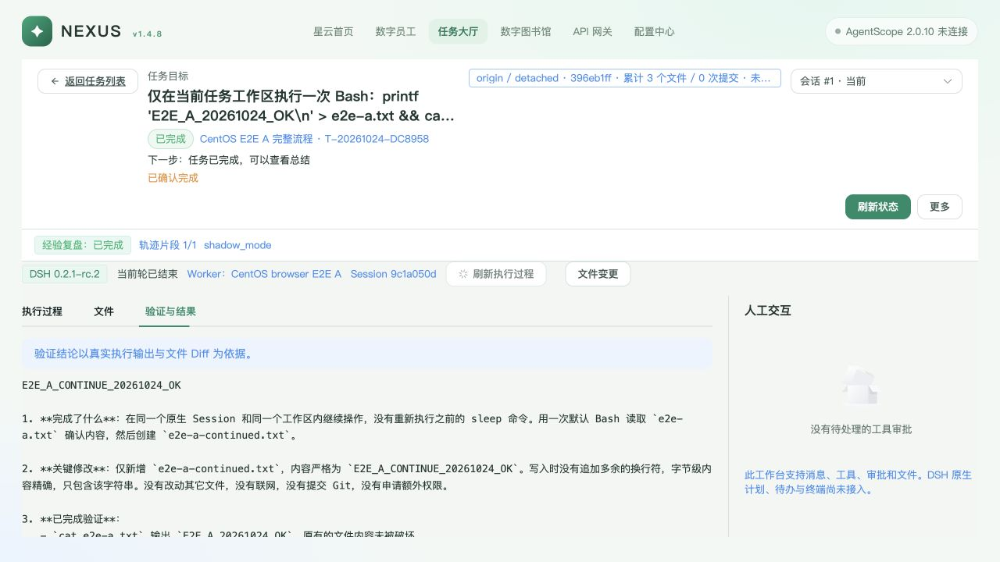

# DSH 任务工作台 E2E（2026-10-24）

## 问题原因与结果

本轮从真实浏览器操作 Nexus，由 CentOS 的两个 Worker 执行任务，并独立读取 API、受理账本和远端文件核实结果。选定的 **8 个场景通过**，发现并修复 **2 个缺陷**。失败尝试和修复后结果分别保留，没有用通过记录覆盖失败记录。

| 缺陷 | 修复前证据 | 修改与修复后验证 |
| --- | --- | --- |
| 创建表单没有仓库字段，任务的 `repository_id` 为 NULL；即使 Worker 绑定仓库，页面启动仍报“任务没有绑定仓库” | `before-fix-repository.json`、`02-before-fix-task-missing-repository.jpg` | 复用仓库接口增加显式选择，将 `repository_id` 纳入创建请求和未保存草稿判断。新任务均从页面选择仓库、创建并启动，API 保留所选仓库；只改仓库后取消也会触发草稿保护。提交 `1dbf5fabb` |
| 过期、跨任务或无效选项的审批拒绝被通用控制通道归类为 IO，误报 Runtime 连接失败 503 | `before-fix-permission-http.json`；客户端忽略负回执的红测见 `permission-regression-before.txt` | Driver 返回明确受理结果，客户端校验回执并沿用现有冲突映射。真实跨任务、无效选项和过期请求均为 409，前两者不消费原审批；真实传输错误仍由回归验证为 503。提交 `ee024b6e2` |

没有放宽路径或审批规则，也没有修改 Task / Worker 占用规则。取消后尚未确认执行停止的两条旧失败夹具，按既有规则继续占用；收尾核查数据库无 Session、无提交、attempt=0，远端账本无对应绑定，再通过现有 `confirm-execution-stop` 接口确认，Worker 恢复空闲。`canceled-fixture-release.json` 同时保留确认前后事实。不能只凭任务已取消或一次即时计数为 0 判断 Worker 已释放。

## 环境与代码

- 分支 `codex/nexus-dsh-acp-runtime`；基线 `4b0caae1e`，修复后源码 `ee024b6e236456a35bd5d77623fe7058822c8a4d`。代码只做本地提交，没有推送或合并。原脏工作树未覆盖。
- 控制端是独立 Nexus API `127.0.0.1:18641`、SQLite、Redis `18642` 和 Celery 复盘队列。浏览器为实际页面，默认视口 **1280×720**；没有将此前 2560×1440 的截图算作本轮证据。
- Linux 为用户测试机 `47.77.219.113`，CentOS Linux 8.2.2004 / x86_64 / glibc 2.28 / kernel 5.15.223，独立 Python 3.11.15、Node 22.23.3、DSH `0.2.1-rc.2`、ACP Python `0.8.1`、bubblewrap 0.4.0。本轮没有再次安装内核或重启整机。
- 两 Worker 使用 `/root/agentwork/nexus-dsh-browser-e2e-20261024/{a,b}`，复用已固定的运行时；控制、执行和真实复盘均经现有 Nexus Gateway `deepseek-flash`。没有模型直连或自动换模型。
- 夹具由 API 创建 Worker、手工装配通道；仓库是本机自有 bare Git 夹具。两个 Worker 绑定同一合成责任员工 `dsh-qa-owner`，Task 的 `responsible_employee_id` 为 NULL。真实 AgentScope 员工目录、生产用户身份、公司私有 Git 认证不在本轮范围。

| 项目 | 任务 A | 任务 B |
| --- | --- | --- |
| Task | `T-20261024-DC8958` | `T-20261024-2AA586` |
| Worker | `dsh-e2e-a-20261024` | `dsh-e2e-b-20261024` |
| binding | `dsh_6d20cdde3ba041038dfc99a677854c8e` | `dsh_20099ff398ef4c95b0a278df267ade4c` |
| native Session | `9c1a050d-b4ad-428d-81e4-94487918e3cb` | `a18d46ff-5ccb-4d4b-9aa8-110f57c746d2` |
| 最终 Task / Worker 占用 | SUCCEEDED / 0 | SUCCEEDED / 0 |
| 原生轮次 / receipt / 消息数 | 3 / 3 / 11 | 3 / 3 / 11 |
| 复盘作业 | `xrj_0434ee8619114a358ebaf5c7289f0510` | `xrj_0c7b621f706c48c487a5202af0eff728` |

两任务 `repository_id` 均为 `b2dd3cc328394995ae303fa99a1df105`。版本、进程身份、远端四个 Python 文件 SHA 和当前服务的前端内容核对见 `preview-handoff.json`、`python-source-overrides.json`、`fix-commits.json`。

## 8 个 E2E 场景

证据均在 [browser-e2e-20261024](evidence/nexus-dsh-acp-runtime/browser-e2e-20261024/)；`scenarios.json` 为本轮结果索引，不是第二份实施计划。页面动作通过真实浏览器完成；用于对抗校验的错误请求、夹具搭建与独立读回明确列为 API / SSH。

| # | 场景与动作 | 独立核实与结果 | 主要证据 |
| --- | --- | --- | --- |
| 1 | 页面选择仓库、分类和 Worker，创建并启动 A / B | 仓库 ID 保留，生成不同 binding / native ID；end_turn 后 WAITING，各占用 1。**通过** | `two-active-tasks.json`、`first-turns-and-scope.json` |
| 2 | 只选择仓库后取消创建 | 出现“放弃未保存的任务草稿？”；取消放弃后仍保留所选仓库。**通过** | `03-repository-only-draft-guard.jpg` |
| 3 | 两任务切换，查看消息、文件、累计 Diff 和当前未提交 Diff | A / B 各自标记正确，远端均无对方文件；B 两种 Diff 均显示新增一行。**通过** | `07-task-b-cumulative-diff.jpg`、`08-task-b-uncommitted-diff.jpg`、`stop-and-permission-results.json` |
| 4 | 页面读取 `../../etc/passwd`；API 请求错误任务 / binding、跨任务审批、非法选项、已过期审批 | 页面拒绝路径；错误绑定 404；后三种审批均 409。跨任务和非法选项不消费 B 的原审批。**通过** | `06-path-escape-denied.jpg`、`after-fix-permission-http.json`、`stop-and-permission-results.json` |
| 5 | 刷新页面；已完成轮次后计划停止两自有 Worker，再以同账本启动并刷新 | binding / native ID 不变，原始 turn/start 数仍为 A=1、B=2，未重投；Task WAITING、占用各 1。**通过** | `before-worker-restart.json`、`after-worker-restart.json` |
| 6 | B 两次独立审批均从页面点击“本次拒绝” | 审批清空，轮次结束；经认证 SFTP 核实两个外部标记文件均不存在。没有点击沙箱升级的允许按钮。**通过** | `12-permission-routing-after-fix.jpg`、`15-permission-denied-without-effect.jpg`、`stop-and-permission-results.json` |
| 7 | A 执行 `START → sleep 60 → LATE`，观察 START 后从页面停止当前回复，再在同 Session 继续 | 停止回执 true，WAITING / MANUAL_INTERVENTION、占用 1；停止约 121 秒后 SFTP stat 证明 LATE 不存在。续接 native ID 不变，生成 `E2E_A_CONTINUE_20261024_OK`；最终 LATE 仍不存在。**通过** | `stop-start-observed.json`、`stop-ui-action.json`、`16-stopped-session-keeps-occupancy.jpg`、`same-session-continue.json`、`final-native-evidence.json` |
| 8 | 两任务从页面确认完成，查看只读态和真实复盘 | 两 Task SUCCEEDED，已关闭任务输入 409，页面没有输入框；夹具停止确认后持续复查 Worker 为 0。两复盘 SUCCEEDED / shadow_mode，SHA 和每任务 11 条消息与独立磁盘解析一致。**通过** | `tasks-confirmed-and-readonly.json`、`canceled-fixture-release.json`、`preview-handoff.json`、`native-review-jobs.json`、`review-crosscheck.json`、`18-completed-and-reviewed.jpg` |

场景 5 是**已完成轮次的计划重启**，不是执行中 SIGKILL。执行中强制退出的历史独立证据仍在主验证报告，不算本轮重复通过。场景 6 只验证拒绝；一次允许由定向单测和此前真实 ACP 短测分别覆盖，不能称为本轮浏览器验证。

## 自动验证与原生证据

| 检查 | 本轮结果 |
| --- | --- |
| Mac `.venv/bin/pytest tests/dsh -q` | **64 passed**，1.46 秒，334 条 warning；终端结果记录在 `checks.json` |
| CentOS 固定运行时 venv 的 `pytest tests/dsh -q` | **64 passed / 0 skipped**，3.66 秒；原始输出 `linux-dsh-tests.txt` |
| `.venv/bin/ruff check app nexus_api tests` | 通过 |
| `web` 的 `npm test` | **30 passed** |
| `web` 的 `npm run type-check` / `npm run build` | 通过；原始 `frontend-build.log`，保留已有大 chunk 警告 |
| OpenSpec / 差异 / 实际密钥值检查 | strict validate、`git diff --check` 通过；原始契约结果 `openspec-validate.json`。提交前对暂存文件检查本次实际 QA 密钥，0 匹配 |

上述是本轮范围。此前 CentOS 207 项与 Ubuntu 全量 1310 项的结果继续作为历史证据，没有对本轮修复重新宣称跑过全量。

红测日志副本 `permission-regression-before.txt` 仅去除行尾空白以通过差异检查，原始输出保留在私有证据目录；原始与提交副本的 SHA 均记在 `checks.json`。

原生 A 共 64 个事件、B 共 62 个事件，**消息数各 11**，没有用事件数冒充消息数。A 的三个 receipt 为成功 / 中断 / 成功，B 均成功；人工完成后归属 Host 均回收。A 摘要 `590c9e5e1c1eda8cafeb8658e9bb9398e0edbcc961475fb3ac81ae7d0d7a4c71`，B 摘要 `2e2e6c02cb916c61acff317e31849a9d0c929e7a11b9e2d7da0fd4526449096d`。两次真实 Gateway MAP / REDUCE 成功，QA 按阶段调用已有扫描函数推进队列；没有发布正式候选，也没有将手工短测当成持续调度验收。

## 复查入口与剩余风险

本轮保留独立测试预览供复查：[任务 A](http://127.0.0.1:18641/tasks/T-20261024-DC8958)、[任务 B](http://127.0.0.1:18641/tasks/T-20261024-2AA586)。两 Worker `auto_claim=false`、`auto_execute=false`，任务已完成、没有活跃执行 Host。API、Redis、Celery 和 SSH 转发保留运行；PID / create_time / cwd 仅代表 `preview-handoff.json` 记录时刻，不能直接用于以后清理。

预览所需凭据仍保留在本机 `/tmp/nexus-dsh-browser-e2e-20261024` 和远端同名私有测试目录，目录 0700、凭据 / 配置 0600；没有复制到 Git。原生全文也未入库或提交。以后关闭预览需重新核实进程身份，再停止自有服务和清理临时凭据；共享 Gateway 保留。

OpenSpec 仍为 **9/13**，不归档、不切正式默认引擎。公司 ARM64 / glibc 2.28、Windows、GLM / Qwen、长 Session、限流、公司一键安装、独立系统身份与网络出口策略、MySQL 8.0.36、真实 AgentScope / Task MCP、100 任务 / 72 小时均未由本轮覆盖。生产验收缺口详见 [主验证报告](nexus-dsh-acp-runtime-verification.md) 和 change 的 `verification.md`。
