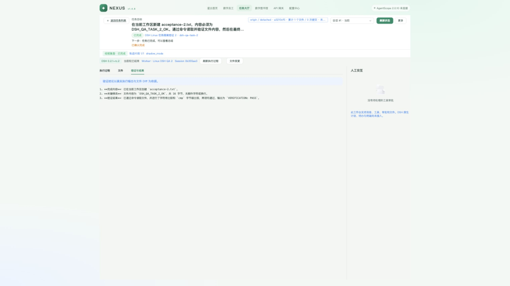

# Nexus DSH ACP Runtime 开发与验证（2026-10-24）

## 问题原因与结论

需求基线 `feat/nexus-dsh-acp-runtime` / `a3511ddba` 只有设计，原 Task 执行入口依赖 OpenCode。此次在独立分支 `codex/nexus-dsh-acp-runtime` 实现 DSH Worker、Runtime、任务工作台和原生轨迹复盘，继续使用现有 Task 状态、Worker 占用、人工确认和候选审核。

**功能闭环与 Linux QA 回归通过；完整平台、模型、安全隔离和长测门禁未通过，不能正式切流。** 用户此前提供的云端 Linux 已连接并测试，其旧 glibc / kernel 和原生扩展加载失败单独保留，不以另一台 Linux 的通过替代。OpenSpec change 保持活动，不归档。

工作树：`/Users/niuniu/.codex/worktrees/nexus-dsh-acp/Astra`。原 `/Users/niuniu/程序/Astra` 的未提交工作未覆盖。P1 提交 `4c48d818b`，P2 提交 `655b325a0`，只读页面收尾 `65665162f`；此前 P0 为 `cdab00f1a`。本次只做本地提交，没有推送、合并或重启正式服务。

## 修改内容

- Worker 每绑定独立 ACP Host / DSH_HOME，固定官方 DSH `0.2.1-rc.2`、ACP Python `0.8.1`。配置 / Skill / MCP hash 冻结；恢复漂移即拒绝。真实健康检查包含 ACP initialize、Gateway 目录、精确模型别名、Skill、MCP 与 Git，不能只看 `--version`。
- SQLite WAL + FULL 持久受理先于原生 prompt，仅存 submission hash、generation、fence 和绑定。重复投递返回 receipt，不重投；重启中的 running 变为 unknown。取消先持久 fencing，再核验 PID / create_time / cwd / 进程组；不能证明停止就保留占用。
- 复用 Worker Gateway 的命令、鉴权、Redis 与 HTTP 数据通道。提交文本只在有 TTL 的临时数据通道中传送；命令审计不存 prompt / transcript。已受理的原生执行不随 WebSocket 断线自动取消或重跑，审批断线默认拒绝。
- 新增 `0002_dsh_runtime` 保存 engine、native ID、配置索引与 fence，保留已发布 `0001_init`。OpenCode 仍用现有原生 Client；抽出共用 Worker 传输和 Task 完成 / 重启业务规则。DSH 不提供 OpenCode API 伪兼容，也不增加 Run 状态机。
- 任务详情按显式 engine 使用 Element Plus 通用工作台或原 OpenCode iframe。DSH 支持原生消息 / 工具、文件、既有 Git Diff、一次审批、停止、原 Session 续接、显式重新开始和人工确认；按 Task + binding + native Session 隔离。未接入的计划、待办、终端明确标示。
- end_turn 只进入待验收，人工确认先回收 Host，再走原 Task 完成 / 复盘。复盘分页核验固定 v4 JSONL、工作区、原生 ID、连续 seq、完成轮次、冻结 SHA 和页间一致性；缺失证据阻止成功复盘，用量保持未知。

## 自动验证

| 检查 | 结果与边界 |
| --- | --- |
| Linux 全量 `tests/platform tests/nexus tests/dsh` | **1310 passed / 6 skipped**，158.24 秒；提供专用真实 Redis，相关 Lua / 跨进程 Worker 用例实际运行。原始输出：`evidence/nexus-dsh-acp-runtime/linux-pytest.txt` |
| 6 个跳过项 | 1 个真实 OpenCode、1 个真实 MySQL、4 个真实 AgentScope；未设置其 opt-in 服务环境，不计通过 |
| Mac 定向 Runtime / 复盘 / DSH | **221 passed**，31.40 秒；DSH 定向集现为 53 项（重新开始接口新增 1 项，定向 7 项通过）。全量 Mac 还遇到现有 Linux-only `os.O_PATH` / 安装脚本检查，未把它当 Linux 验收 |
| Ruff | Mac / Linux 的 `app nexus_api tests` 与探针检查通过 |
| 前端 | `services/nexus-api/web` 的 type-check / build 通过，构建产物已更新；保留已有大 chunk 警告。未改 chat-island，未声称真实 AgentScope 聊天通过 |
| Migration | SQLite 新库、重复 upgrade、已发布 `0001_init` → `0002` 的原绑定 / 状态 / 用量保留与 native ID 回填通过；MySQL 8.0.36 实库迁移未验证 |
| 契约 / 差异 | OpenSpec strict validate、Scenario 核验、`git diff --check`、实际 QA 密钥值的暂存区检查；结论见 change 的 `verification.md` |

代码测试以修正后的原生消息计数为准：tool/call、内部状态和 turn 事件不能充当额外消息。实测复盘作业最初记录了原生事件数；随后对相同冻结轨迹独立重读，消息数分别为 5 / 21，摘要不变。`native-review.json` 同时保留当时结果与重读值，没有改写原生记录或伪造复盘结论。

## Linux 真实产品闭环

Linux QA：Ubuntu 24.04 / ARM64 / glibc 2.39 / Python 3.12.3 / Node 22.23.3。独立目录 `/tmp/nexus-dsh-integration-20261024`，两个 Worker 指向两个独立 agentwork 仓库；统一 Nexus API 在 Mac 独立端口 `18641`，Gateway 经自有 SSH 隧道访问真实 `18511/v1`，路由 `deepseek-flash`。这是跨进程 / Linux Worker 联调，**不是公司跨主机 HTTPS 部署验收**。

两 Worker 绑定同一个测试责任员工 `dsh-qa-owner`，不启动第二套调度器。AgentScope 未连接；该测试不覆盖数字员工聊天或真实 Task MCP 业务澄清服务。

| 任务 | 绑定 | 原生 Session |
| --- | --- | --- |
| `dsh-qa-task-1` | `dsh_81a62b3e9ade48158e5c94b94c855aff` | `fb7dae5a-c7d3-4f1d-b74f-c8c9b1d3b445` |
| `dsh-qa-task-2` | `dsh_f0d33dd1872d454aa6ca5f0ba507336d` | `0b355ae3-3047-4628-aa17-4038f45fa8f3` |

1. 两任务经真实 `/start` 受理，各自写入 `acceptance-1.txt` / `acceptance-2.txt` 并由 Bash 读取验证。原生 end_turn 后 Task 为 WAITING，Worker 仍占用；没有自动确认业务成功。
2. 从任务大厅切换、刷新、查看原生消息 / 工具、读取文件和打开 Git Diff。未出现另一任务的验收文件或消息。跨 Task / native ID 返回 404，路径逃逸返回 403，见 `api-verification.json`。
3. 页面实际处理一次拒绝、一次 allow-once；允许操作仅写本次自有 Home 标记，内容实测匹配，没有持续授权。首个错误 Home 路径的 ENOENT 不算审批成功。
4. 页面发送 `START → sleep 30 → LATE` 的受控命令，先通过 SSH 证明 START 存在，再点击停止当前回复。86 秒后 LATE 仍不存在，原生停止已确认；Task 保持等待。随后发送续接要求，**原生 ID 不变**，读取原文件并收到 `CURRENT_SESSION_CONTINUE_OK`，没有重跑长命令。
5. 两任务均从页面人工确认完成，Task 为 SUCCEEDED，Host 回收，未知用量不填 0。分别冻结 35 / 118 个原生事件；现有 MAP / REDUCE 通过真实 Gateway 完成，均 `SUCCEEDED / shadow_mode`，没有发布正式候选。现有 candidate 写入 / 人工审核路径由回归覆盖。
6. 2560×1440 真页面：document scrollWidth = 2560；工作台宽 1560，高约 1117，内部滚动为 auto。修复了长历史被 el-tabs 裁切和历史工具调用永久显示执行中的问题。截图见下方和 evidence 目录。

## Worker 强制退出与恢复

另建任务 `T-20261023-4D7D03`，真实受理为 running 后核实 Worker PID / create_time / cwd，再 SIGKILL 本次自有 Worker；未杀其他服务。原生绑定 `dsh_70dae022c43d43e8bd4401c8747bcf0e` / Session `8533b3df-0c50-4c02-af71-7bf9f60ed3f4`。

重启同一 journal 后状态 unknown，原生 ID、submission、fence 保持，Task 仍 RUNNING / TRANSPORT_RECOVERY，新输入 409。磁盘只有 1 个原生文件、1 次 turn/start、1 个 receipt，没有自动投递第二次 prompt。显式停止后 fence 从 1 到 2，进程组停止确认，Task 才为 CANCELED。该用例的工具尚未写 START；它证明受理 / 重启恢复，不能替代上面的工具中途取消证据。

该绑定 10 条控制命令的 payload 文本字段为 0，副作用回执 transcript 字段为 0。其后另经页面显式重新开始，创建原生 Session `c650151c-9d82-4636-b6bd-4135e030049e`，页面选择会话 #2；旧绑定被 supersede 且仍只读，最后停止测试任务。显式新轮次与自动重投分开取证，见 `explicit-restart.json`。完整元数据见 `worker-crash-recovery.json`；本机 PID / 端口只代表本次测试，不能用于后续清理。

## 未通过与未验证

| 项目 | 真实结果 |
| --- | --- |
| 用户的云端 Linux | 已安全连接，x86_64 / glibc 2.17 / kernel 3.10.0 / Python 3.11.17。`--version` 可返回，但实际 ACP 初始化失败：原生 binding 不可用。普通 npm ci 还遇到 spawn ENOMEM。最终预检明确拒绝该平台，未升级系统或干扰原有 Worker |
| 官方 Linux 基线 | Node 22 x64 / ARM64 官方基线为 glibc 2.28+、kernel 4.18+，见 [固定版 BUILDING.md](https://github.com/nodejs/node/blob/v22.23.3/BUILDING.md)。系统条件满足后仍必须通过真实 ACP，不能据平台列表声称已支持 |
| 最新完整 Linux 探针 | 一次真实 MCP 已调用，但模型首次 nonce 少后缀，严格断言失败；明确 JSON 参数后复测首轮通过，第二轮 Gateway `503 / NO_ELIGIBLE_NODE / CIRCUIT_OPEN`。两次均清理自有进程组并保留失败报告；观察到任务工具调用恢复后，独立复测仍在次轮遇到 503，第三份报告也保留，未自动改模型 |
| 历史 P0 | 2026-10-23 Linux 的 17 PASS / 2 UNVERIFIED 只作为历史证据；不能覆盖本轮失败。Mac 最终复测也曾遇到 Gateway 503；Qwen 不健康，GLM 未配置 |
| 系统安全 / 离线部署 | 私有目录、配置白名单和 hash 已实现；完整离线包、公司安装器、独立系统身份、网络出口与 OS 工具限制尚无完整实证。真实 Bash 曾提示 Landlock 部分生效，不能声称 OS 隔离通过 |
| 生产门禁 | 公司 ARM64 / glibc 2.28、Windows、GLM / Qwen 工具流、长 Session、限流、同模型任务对照、100 任务 / 72 小时未完成；保持默认 OpenCode |

本轮临时进程、隧道和测试凭据在取证后按所有权清理；仅保留脱敏元数据、测试输出和截图。原生全文没有复制到 Git 或平台消息表。

清理记录见 `cleanup.json`：Linux QA 关闭两自有 Worker，清除 10 个临时凭据文件；云端清除 2 个，均无残留测试进程。清理时 Linux 的 Unix 创建时间随时钟修正偏移 1 秒，旧时间戳检查已拒绝直接终止；再次以精确脚本、独占 journal / flock、cwd、boot start ticks 和 pidfd 核实后发送 SIGTERM。产品严格进程身份检查遇到此类时钟变化仍会保留占用，需要人工核对，未降低判断标准。原有 Gateway 身份与进程保持。
