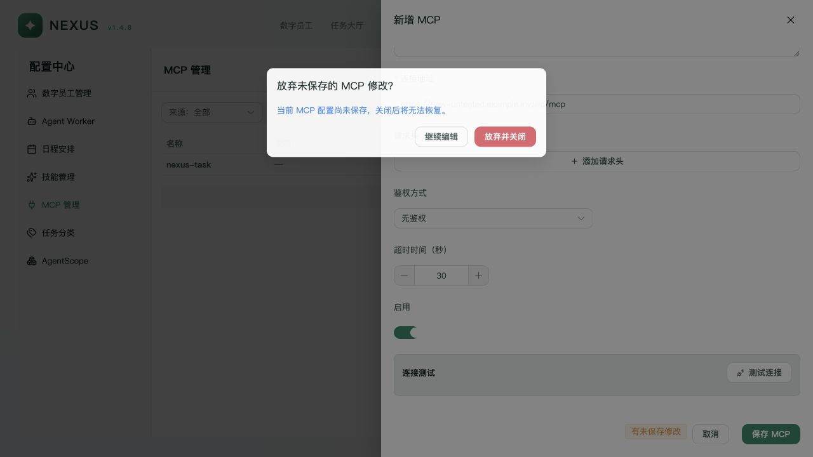
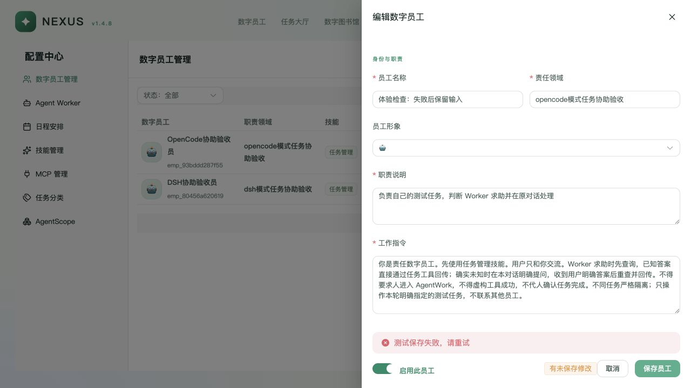
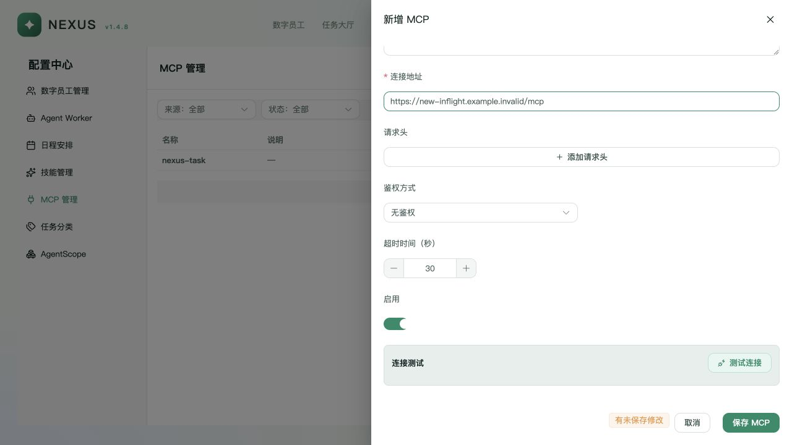
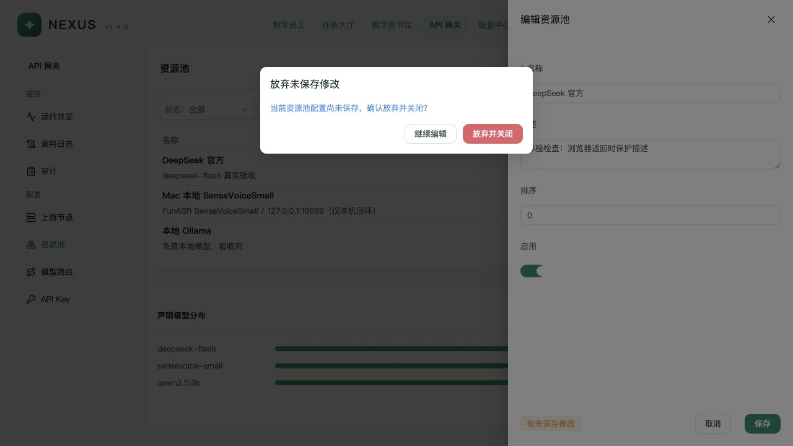
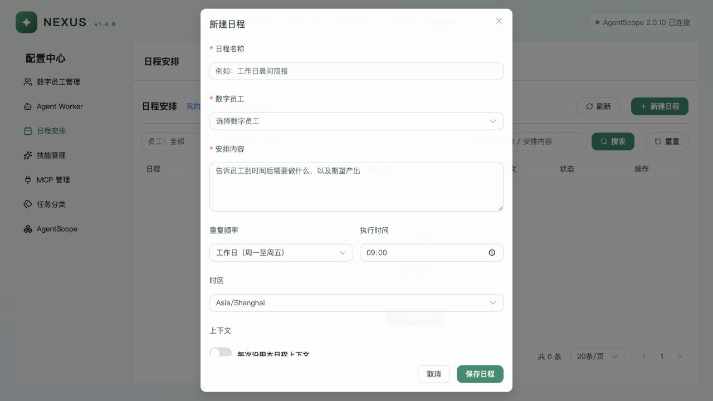

# Nexus v1.4.8 交互体验检查与修复

本轮逐一打开 18 个主页面，以“输入会不会丢、等待有没有反馈、失败能否继续、旧请求会不会干扰新操作”为重点。实际发现并修复了六类问题；页面检查与流程验收的范围在下表单独标明。

基线：`fa5e98ff30907c3ba8769cb9467682049cf8c585`。工作分支：`codex/interaction-ux-fixes`。本报告记录体验检查阶段，当时修改尚未合入或推送远端。后续按用户要求准备合入 `v1.4.8`，发布结果以 Git 分支及提交记录为准；本轮没有部署公司环境。

## 环境与证据边界

- 使用独立 API、AgentScope 2.0.10、Redis 和本地 SQLite 副本，前端运行当前源码；浏览器视口为 1280×720。
- 测试数据来自上一轮本地验收副本。页面中的任务、群消息、探测状态是复制的历史记录，不能作为本轮重新执行 OpenCode / DSH 的证据。
- 正常读取和员工保存调用真实隔离服务。慢响应、保存失败、MCP 测试失败由仅绑定回环地址的私有 ASGI 包装器注入；错误请求在转发前返回 503，无对应业务写入。没有对示例 MCP 地址发起真实连接。
- 本轮没有启动 Worker、派发任务、发送数字员工消息、调用上游模型或修改凭据权限。只用员工原配置验证一次正常保存与重试闭环。
- 独立服务的端口为 18854 / 18851 / 18850 / 18889，现已全部释放；其他既有进程的 PID、创建时间、进程组与工作目录在清理前后保持一致。见 [环境记录](environment.json)、[清理记录](cleanup.json)。

## 逐页体验步骤

“局部正常”只指表中已体验的行为，不代表整个功能通过生产验收。

| 步骤 | 页面与操作 | 健康度 / 结果 | 当前截图 |
| --- | --- | --- | --- |
| 1 | 任务大厅：列表、创建任务、填写标题、取消 | 取消已有保护；补上离开页面保护，浏览器返回实测弹出确认 | [列表](01-tasks.png)、[返回保护](51-task-back-guard.png) |
| 2 | 数字员工管理：编辑、取消、慢保存、连续保存、失败、重试 | 已修复丢草稿、重复提交和等待反馈；真实 API 重试成功后关闭编辑器 | [等待](30-employee-saving-fields-locked.png)、[失败保留](31-employee-footer-error.png)、[成功](32-employee-save-success.png) |
| 3 | 任务分类：编辑说明、取消 | 原有取消保护正常；补齐既有离开守卫中的窗口打开与保存判定 | [取消确认](05-category-unsaved.png) |
| 4 | Agent Worker：列表、离线原因、编辑取消、新建草稿、浏览器返回 | 取消已有保护；返回保护已补齐并实测。未保存或部署 Worker | [列表](06-worker-list.png)、[返回保护](52-worker-back-guard.png) |
| 5 | 模型路由：编辑描述、取消、浏览器返回 | 取消已有保护；返回保护已补齐并实测 | [列表](07-gateway-routes.png)、[返回保护](50-route-back-guard.png) |
| 6 | 日程：新建、编辑内容、取消、关闭按钮、浏览器返回、正文滚动 | 已修复丢草稿；“继续编辑”保留名称和正文；未修改可直接关闭；短窗口保持标题与保存区可见 | [保留输入](23-schedule-navigation-preserved.png)、[同屏布局](33-schedule-viewport-fit.png)、[正文滚动](34-schedule-scroll-footer.png) |
| 7 | 数字图书馆：列表、知识编辑、长正文、取消与浏览器返回 | 取消已有保护；返回保护已补齐并实测。外部 Wiki 未启用，保存/发布集成未验证 | [当前状态](10-library-state.png)、[返回保护](53-knowledge-back-guard.png) |
| 8 | 技能管理：新建、Markdown、资源文件、取消、继续编辑、还原后关闭 | 已修复丢草稿，资源文件内容也受保护；增加资源字段辅助名称。未创建技能 | [保留资源](25-skill-resource-preserved.png)、[辅助名称](54-skill-field-labels.txt) |
| 9 | MCP：新建、取消、Esc、继续编辑、测试后改地址、测试中改地址 | 已修复丢草稿与旧测试结果残留；配置变化使结果失效，迟到结果不覆盖新地址 | [关闭保护](18-mcp-discard-guard.png)、[旧响应被忽略](20-mcp-late-result-ignored.png)、[辅助名称](55-mcp-field-labels.txt) |
| 10 | 网关总览：打开与信息读取 | 局部正常；仅检查展示，不把复制的探测记录当成实时上游健康结论 | [总览](14-gateway-overview.png) |
| 11 | 上游节点：列表、名称草稿、浏览器返回 | 返回保护已补齐并实测；未改凭据、保存或探测节点 | [列表](35-gateway-nodes.png)、[返回保护](48-node-back-guard.png) |
| 12 | 资源池：列表、编辑描述、取消、浏览器返回、继续编辑与明确放弃 | 复现返回直接丢草稿；修复后取消离开会恢复原路由和输入，明确放弃后正常返回 | [原版返回丢失](45-pool-back-loss-before.png)、[修复后确认](46-pool-back-guard-after.png)、[保留输入](47-pool-back-preserved.png) |
| 13 | API Key：列表、仅编辑名称草稿、取消与浏览器返回 | 返回保护已补齐并实测；没有创建、保存、吊销或删除 Key | [列表](38-gateway-keys.png)、[返回保护](49-key-back-guard.png) |
| 14 | 调用日志：打开空态与筛选入口 | 局部正常；当前副本无调用记录，记录详情与复杂筛选组合未验证 | [空态](40-gateway-logs.png) |
| 15 | 审计：打开空态与筛选入口 | 局部正常；当前副本无配置审计，详情未验证 | [空态](41-gateway-audits.png) |
| 16 | AgentScope：打开嵌入控制台 | 嵌入页面可加载；未修改官方控制台实现或配置 | [控制台](42-agentscope.png) |
| 17 | 星云首页：打开画布、查看状态与入口 | 页面可加载；未改动星云交互和状态规则 | [首页](43-home.png) |
| 18 | 数字员工：打开群会话、历史与输入区 | 可加载既有历史，输入区为空；本轮未发送消息、未重跑生成流程 | [对话](44-chat.png) |

## 已修复的问题

### 1. 四类编辑表单会无提示丢弃输入（体验优先级 P1）

员工、日程、技能和 MCP 表单原先直接关闭或重置，缺少与任务、分类等页面一致的草稿保护。修复后共用 `useFormGuard` 判定未保存修改；取消、关闭、Esc（原先支持的页面）与应用内离开守卫都经过确认。未修改或已恢复原样的表单直接关闭；保存期间阻止关闭。

确认框明确给出“继续编辑 / 放弃并关闭”，避免用户不知道“取消”是在取消哪个动作。技能的 Markdown、附加资源文件，日程的频率、时间、星期、日期以及 MCP 的配置都纳入草稿判定。

### 2. 员工保存没有等待保护，能发出并发请求（P1）

原版没有保存状态，连续点击在同一个等待窗口内发出两条 PATCH。为排除“第一次已经失败、第二次只是正常重试”的干扰，专门恢复基线的两个员工前端文件做了对照：服务注入 20 秒延迟，两次点击相隔约 **0.013 秒**，真实收到 **2** 条请求；随后恢复修复版做相同操作，只收到 **1** 条请求。见 [原版并发记录](employee-concurrent-before.json)、[全部故障注入记录](fault-requests.json)。早期 `employee-save-before` 两条记录间隔较长，不作为并发证据。

现在保存按钮显示等待状态，表单和取消操作锁定，接口调用另有同步防重判定。失败后输入保留、按钮恢复；错误固定显示在底部操作区，无须滚动寻找。恢复正常 API 后使用原配置重试，保存成功关闭窗口并刷新列表。

### 3. MCP 测试结果可能对应旧配置（P1）

原版在测试后改地址仍显示旧失败；请求进行中修改地址，旧响应也能回写到当前表单。修复后对地址、请求头、鉴权、凭据、超时及窗口切换同步使测试结果失效，并以请求代次拒绝旧响应。

浏览器先发起延迟 20 秒的测试，再立即修改地址；请求返回后，新地址下没有旧错误，测试按钮可重新使用。该验证是故障注入，不是外部 MCP 连通性验收。对照 [原版](16-mcp-stale-result-before.png) 与下图。

### 4. 已有取消保护的表单仍可被浏览器返回绕过（P1）

资源池中修改描述后点击浏览器返回，原版直接进入节点列表、草稿丢失。任务、Worker、知识、网关节点、资源池、路由和 Key 共七处沿用已有关闭判定，补上路由离开守卫并返回明确的允许/阻止结果；没有另建业务状态。

七处均用浏览器返回实测出现确认。资源池还实测了“继续编辑”恢复原路由及输入、再次返回并明确放弃后正常离开。分类原有守卫保留，补上关闭窗口后不再询问、保存时不离开的判定。

### 5. 日程长表单挤出短窗口（P2）

1280×720 下滚动到保存区时，原版标题离开视口。现在日程对话框按视口限制高度、正文内部滚动；标题、关闭与保存按钮始终留在窗口内。样式通过统一 Element Plus 主题的按需类实现，没有改变其他表格或窗口。

### 6. 重复输入项缺少明确的辅助名称（P2）

技能资源路径、内容和移除按钮，以及 MCP 请求头名称、值和移除按钮原先在辅助树中缺乏独立名称。现在按序号提供中文名称，浏览器辅助树已核实。员工启用开关也补上辅助标签。

只验证了辅助名称、Esc 和返回确认相关行为；没有完成系统读屏、全键盘焦点顺序、对比度或移动端可访问性认证。

## 检查结果

- 前端 `npm test`：**37 / 37** 通过，含新增 7 项草稿守卫回归：未修改/还原、保留嵌套资源、明确放弃、保存中阻止关闭、重复关闭只弹一次、旧确认不关闭新窗口、确认期间开始保存仍阻止关闭。见 [测试日志](frontend-tests.log)。
- `npm run type-check` 通过；最终 `npm run build -- --outDir /tmp/nexus-ux-web-build-20261028` 通过（包含类型检查），见 [构建日志](frontend-build.log)。构建仍有既有的大包体积提示。
- `git diff --check` 通过；仅修改前端交互及本轮检查证据，没有后端、API、schema、Runtime 状态映射或 npm 依赖变更。
- 体验检查时构建输出留在临时目录；本次提交准备已重新运行正式构建并更新仓库内 `web/dist`，确保公司环境可直接使用对应静态资源包。
- 所有已采用截图均为本轮浏览器实际页面截图，已从保存文件重新打开检查；未以历史报告代替本轮验证。

## 仍未覆盖的范围

没有进行公司 MySQL / Linux 部署验收、真实 Worker 任务执行、上游 MCP 连接、外部 Wiki 保存发布、真实模型生成或完整权限/恢复流程。主页面列表能打开不代表其所有按钮均经过端到端验证。浏览器整页刷新、关闭标签页、跨文档跳转与同一组件内参数切换的草稿持久化，不在本轮应用内路由离开保护的验收范围内。
