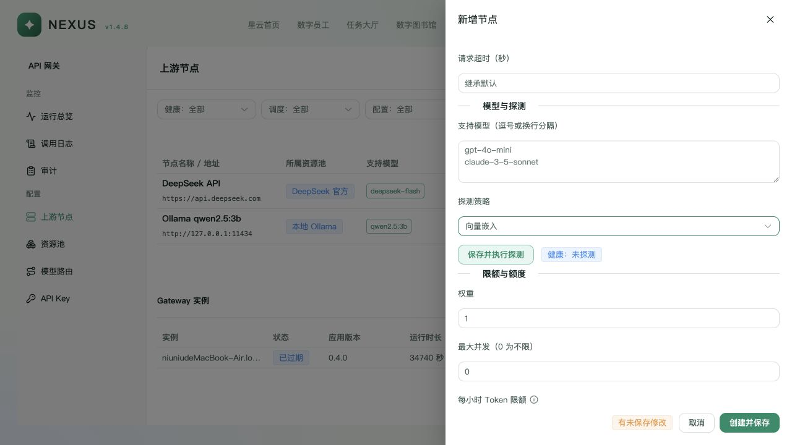

# Nexus v1.4.8 部署与统一网关修复核验

日期：2026-10-22。复核与修改基线：`11621869f`。实现契约：`openspec/changes/nexus-deployment-gateway-closure/`。本记录区分本地可验证结果和公司现场边界，不将模拟上游视为真实供应商推理。

## 原因与修改

| 原因 | 最终修改 |
| --- | --- |
| 独立配置没有完整进入干净服务进程，重启后模式、网关 key、监听端口或模型可能恢复错误默认值 | 安装器写入同一受保护运行环境；稳定生成并登记平台 key 摘要，幂等复用；保存监听、执行模式、模型与复盘连接配置；启动预检识别运行环境文件 |
| 默认 Worker 部署仍检查控制机 OpenCode，安装模型节点绑定指定厂商 | Worker 模式跳过控制机 OpenCode；实际 Worker 保留固定版本检查；安装不创建供应商节点或验证供应商 key |
| Worker 根地址与 /v1 混用；本机、共享 Serve 和特殊测试模型存在直连路径 | 规范唯一 /v1；受管主/小模型只启用 nexus-gateway；复用前校验实际配置，不接管配置不合规的旧进程；删除远程测试模型绕过 |
| embedding 未经网关，embedding-only 节点被聊天探测误判 | 新增共享数据面的 /v1/embeddings 和 EMBEDDING 探测；页面可选；复用授权、路由、额度、租约、故障和审计管线 |
| 图书馆允许独立 embedding credential | 仅接受 model_route_id 和正整数 dimensions，登记指向网关的官方 AgentScope credential；失败不直连 |
| 既有 llm_wiki 使用随机 token/project，健康状态被当作项目可用 | 必须显式提供真实值；同一 token 验证项目 search；失败终止，不随机生成、不把 health 当作项目权限 |
| README/开发约定与实际部署不一致 | 更新 README.md、AGENTS.md、环境模板、AgentScope 与部署指南，明确两个 MySQL 库、Redis 和外部服务边界 |

## OpenSpec 核验

完整性、正确性与一致性均按 proposal、design、spec 和 tasks 核对；不修改 Astra 历史 spec，不新增 schema，不修改官方 AgentScope 安装包。

| Requirement / Scenario | 实现与验证证据 |
| --- | --- |
| 服务环境可恢复：干净进程与重复安装 | install_nexus.sh；test_deployment_gateway 的 env -i、重复 key、外层引号/JSON、无命令执行、systemd 加载文件和自定义复盘配置测试 |
| 统一代理：嵌入请求转发/拒绝 | gateway/server.py；test_gateway_embeddings 验证向量/模型映射/usage、401/403/400/429、503不重试及租约释放 |
| 知识库使用网关模型 | library_kb.py；test_knowledge_mapping 通过真实 httpx 模拟传输检查 credential 端点与授权、模型和维度 |
| Worker 地址规范 | gateway/urls.py、remote_provisioning.py、worker_channel.py；合法根地址与 /v1 规范化，非法路径/凭据 URL 拒绝 |
| 受管 Serve 禁止绕过 | opencode_model.py、opencode_server.py、opencode_local_server.py；test_deployment_gateway/test_service_gateway/test_remote_provisioning 覆盖实际配置拒绝、主/小模型、特殊模型仍走网关；独立 CLI 不属于受管 Serve |
| 外部知识服务缺配置/项目不可访问 | preflight 与 app.deployment；缺 token 不生成伪造凭据；health 200、项目 403 明确失败 |

| 核验维度 | 结果 |
| --- | --- |
| 完整性 | 6/6 实施任务；3 项 Requirement |
| 正确性 | 8 个 Scenario 均有实现及本地验证证据 |
| 一致性 | 复用既有网关/存储边界；无 schema 或官方包修改 |

严格 OpenSpec validate 通过；本地核验无 CRITICAL 或未处理的源码 WARNING，现场未验证项见下文。独立只读源码复核最初发现三项 Important（共享 Serve 复用、特殊模型绕过、模型/复盘配置恢复），修复后复核确认全部关闭，未发现新的确定阻塞项。

## 验证结果

- 本机 MySQL 实际 `SELECT VERSION()` 为 **8.0.36**；服务保留运行。之前的 8.4 已移除。
- 真实 MySQL 冒烟：**1 passed**。验证 Nexus 53 张业务表和版本表、InnoDB/外键、独立官方 AgentScope SQL、长文本/私聊/团队/消息顺序、服务重启、任务取消、IM 领取并发，以及实际 Gateway → 固定向量上游的 HTTP 转发、探测和模型映射。向量上游是专用测试 HTTP 服务器，不是实际厂商模型。
- 后端最终回归：**1232 passed、18 skipped、3 deselected**，181.94 秒。命令为 `pytest tests/platform tests/nexus --ignore=tests/platform/test_worker_agent_files.py -k "not test_install_marks_inside_the_operation_and_serves_files and not test_install_script_rejects_python_below_3_11 and not test_install_script_installs_venv_package_for_the_selected_python" --maxfail=3 -q --disable-warnings`。
- 最后针对性部署、远程配置和启动测试：**62 passed，2 deselected**（Linux 专属安装验证在 macOS 排除）。
- Ruff、shell 语法检查、git diff --check 与 OpenSpec 严格校验通过。
- 前端 type-check、build 通过；Node 单元测试 **30 passed**。仅网关相关页面源码改变，聊天岛没有源码变化。
- 真实浏览器打开网关新建节点抽屉并选择“向量嵌入”，确认无须 SSE 探测；退出时放弃表单，未保存或改变现有节点。开发页面用于确认控件，真实 MySQL 测试单独验证后端。

## 剩余风险与现场验收

- macOS 不执行 Linux 远程安装器三项用例及 Linux Worker 文件模块；公司 glibc、Python/venv、systemd、安全策略和网络需要现场执行。systemd 文件加载路径已由捕获 unit 和干净子进程测试覆盖，不代表现场 systemd 已运行。
- 真实供应商聊天、embedding 与远程 Worker 长任务需要公司路由和授权 key 现场验证；模型列表可用不能代替推理成功。
- 外部 llm_wiki 的模型端点由该服务运维配置成可达 Nexus 网关；Nexus 没有其远程模型配置 API。项目鉴权通过不能证明实际 ingest/query 已走网关，须联合网关请求日志验收。
- 公司 MySQL sql_mode、DDL 权限、TLS、容量、多节点并发及备份恢复尚未现场验收。本变更只面向全新空库，不支持旧库升级/导入。
