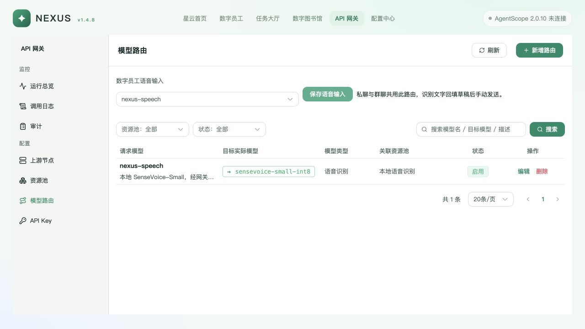
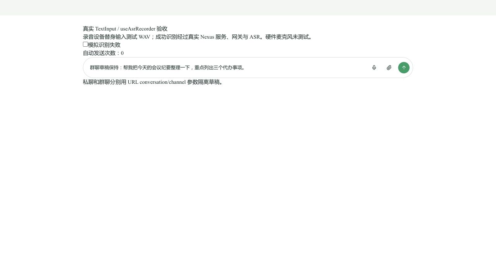

# Nexus v1.4.8 语音输入与网关修复

分支 `codex/worker-container-deploy`，基线 `a3f429e7c`。继续使用已有隔离 worktree，前两轮 Worker 部署与任务分配修复保留；原始工作区未改动。实现和验收记录随修复分支交付，提交与远端状态以 Git 为准。

## 原因

聊天岛固定请求 `/api/asr/transcribe`，Vite/Nginx 将其直连 `127.0.0.1:19899`；统一服务没有语音配置/转写路由，网关没有音频转写入口。原实现只能绑定同机服务，无法通过网关管理独立 ASR 模型。

## 改动

- 网关路由增加 CHAT / EMBEDDING / ASR 类型，模型路由页可配置语音识别模型与请求名→实际模型名；节点增加 ASR 音频专项探测。
- 模型路由页增加“数字员工语音输入”，只选择已启用 ASR 路由并保存到数据库，私聊/群聊共用。修改配置记录真实用户身份审计；地址/凭据只由网关节点管理。
- `/api/asr/transcribe` 现在由统一 Nexus 服务验证用户身份，读取路由并使用服务端稳定 Key 调用网关 `/v1/audio/transcriptions`。浏览器不能覆写模型、上游或 Key。无配置/禁用/类型不符明确失败，不回退直连。
- 网关在现有请求生命周期内解析和重建有界 multipart，复用认证、Key 模型授权/吊销/额度、别名、节点健康/调度/并发与调用元数据。上游已返回失败不重复发送；协议错误不冒充成功；所有出口释放租约。文件最多 12 MiB，仅支持非流式 JSON，Token 用量未知保留 unknown。
- 独立 SenseVoice API 增加 `/v1/models` 与 `/v1/audio/transcriptions`；沿用原引擎、解码、时长、并发限制。上传先整体限制后在内存解析，不将允许范围内的录音 spool 到磁盘；校验日志仅记录错误数量，不打印原始输入。
- 删除开发和 Nginx 固定本机直连；Nginx `/api/` 上传限制包含表单开销。更新 ASR 集成和 Linux 部署文档，旧直连示例改为网关说明。
- 员工和 Worker 主模型只接受 CHAT；知识库要求 EMBEDDING，避免 ASR 路由进入 OpenCode 主模型候选。
- 新增 `0002_gateway_speech`，保留已发布 `0001_init`。迁移纯 EMBEDDING 探测节点池的路由类型；混合池需管理员核对。Nexus 服务启动只校验当前 schema。

兼容转写接口使用 model/file multipart 与 text JSON 的约定，参考 [官方音频转写接口](https://developers.openai.com/api/reference/resources/audio/subresources/transcriptions/methods/create)。本实现只支持上述非流式 JSON 子集，不声称支持流式字幕、实时语音或全部模型选项。

## 验证

| 层次 | 当前证据 |
| --- | --- |
| Linux 统一服务完整回归 | `tests/platform tests/nexus`：1322 passed / 8 skipped，223.53 秒；真实私有 Redis，经隔离回环隧道，日志 `/tmp/nexus-speech-linux-final-full.log`（Lima VM） |
| 最后补充迁移场景 | 本机新鲜 schema / 语音针对性 23 passed；Linux 最终迁移回归 6 passed，覆盖已有路由与纯嵌入池 backfill |
| ASR 独立服务 | 22 passed；真实已安装的离线 SenseVoice 模型，包含 WAV/WebM、兼容接口、错误模型、格式、时长和大小限制 |
| 前端 | Vue 测试 31 passed，聊天岛测试 10 passed；两端 type-check / build 通过。保留已跟踪的构建产物；大 chunk 与 mime-types externalized 警告未阻断构建 |
| 数据库 | 私有 MySQL **8.0.36**，无网络监听：空库 upgrade head 成功；0001_init 写入路由后升级成功，路由保留且标记 CHAT，语音配置表存在。实例已安全关闭，未连接或修改用户原有 MySQL |
| 页面 | 真实生产构建 + 真实隔离 API 页面保存 ASR 路由，刷新后仍显示，编辑页类型/模型映射正确。不是模拟配置 API |
| 真实链路 | 独立 ASR → ASR 专项探测 → 启用节点 → ASR 别名路由 → 统一服务上传真实 5 秒 WAV → 网关 → 实际模型，HTTP 200；请求元数据见 runtime.json |
| 重启与失效 | 重新启动统一 API，数据库路由继续生效并再识别成功；禁用路由返回 422，无新增网关调用；恢复后识别成功。ASR 也已按当前源码重启 |
| 输入交互 | 真实 TextInput/useAsrRecorder 的独立浏览器 harness，录音设备用测试 WAV 替身：私聊原草稿追加文字、群聊不串草稿；模拟一次 HTTP 故障后原草稿保留、显示重试；关闭故障后重试经过真实网关成功，发送回调计数始终为 0。此项不等于硬件录音或完整 AgentScope 对话 E2E |
| 静态与契约 | Ruff、git diff --check、OpenSpec strict validate 通过；单一 tasks 清单与场景核验更新 |

第一轮扩大回归有一个旧测试仍要求直连 19899，按新契约更新为统一服务/网关入口后，第二轮全套通过。最早的 ASR 全套因 worktree 无模型文件而报错；临时只读复用已有权重后重新完整执行，未下载模型。更早的旧嵌入测试 fixture 缺少新类型字段，按实际 API 契约补齐后验证通过。

## 本地部署与使用

本轮隔离环境仍在运行，便于查看与使用：

- [API 网关 → 模型路由 / 语音输入配置](http://127.0.0.1:52789/gateway/routes)，验收 UID `local-speech-qa`。
- 独立 ASR 根地址 `http://127.0.0.1:52787`，模型 `sensevoice-small-int8`。
- 网关 `http://127.0.0.1:52788/v1`，请求模型 `nexus-speech`。
- 进程身份记录 `/tmp/nexus-speech-20261022/processes.json`；稳定调用密钥仅存私有运行配置，不进入仓库或报告。

这是独立本地验收部署，未改写原有 19899 服务、公司环境或原始工作区。机器重启不会自动托管这些验收进程。正式部署按 [集成说明](../../services/nexus-asr/docs/nexus-integration.md) 执行迁移、配置节点/路由，并让服务端 Key 获得对应模型权限。

## 剩余风险

- 公司真实 Nginx `nginx -t` / reload、跨机网络与 HTTPS、EulerOS 环境及实际登录链路未验收。
- 硬件麦克风权限/设备、真实私聊/群聊完整录音到 AgentScope 发送未验收；本次输入 harness 不发送消息。
- 数据库升级需先备份并统一发布 API/网关进程；混合模型池既有嵌入路由需要人工确认类型。
- 本地部署只使用已有离线模型。公司 Linux 模型安装、离线依赖包与正式进程托管仍按目标环境验证。

## 页面证据

