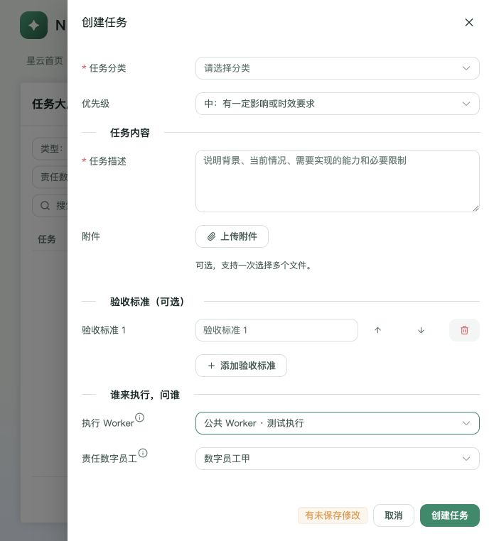

# 任务分配仓库限制修复

日期：2026-10-22。基线 a3f429e7c，继续使用 codex/worker-container-deploy 分支。

## 原因

前一轮保留了任务与仓库的业务关联，却遗漏删除其分配限制。Dispatcher 跳过没有 repository_id 的任务，自动分配和 Runtime 启动同时要求任务与 Worker 的 repository_id 一致；API、MCP 和任务表单还通过 category_ids 限制候选。Worker 创建页和 API 又要求配置任务分类，表单要求指定数字员工，公共 Worker 无法正常创建。

## 修改

任务仓库字段、仓库绑定和已有数据保留，不执行数据库迁移。

| 条件 | 分配规则 |
| --- | --- |
| Worker 不支持任务类型 | 拒绝 |
| 任务未指定责任数字员工 | 所有支持该类型的 Worker 可作为候选 |
| Worker 未绑定数字员工 | 公共 Worker，可服务任意责任数字员工 |
| 双方都指定数字员工 | 必须一致 |
| 任务与 Worker 仓库不同，或任务未绑定仓库 | 不阻止分配或启动 |
| 任务分类与 Worker 配置不同 | 不阻止接单 |

类型/数字员工资格集中在 app/runtime/assignment.py，自动分配、API 创建/编辑、MCP 创建/指定、启动前复检共用。已领取但未启动的恢复路径同样检查资格，并跳过不兼容记录，避免阻塞后续可恢复任务。指定 Worker 的任务仍只分配给该 Worker；健康、维护、能力已应用、占用、auto_claim、父任务依赖保护保留。

执行快照和 base commit 取实际 Worker 的工作区；任务 repository_id 不被改写。执行继续使用所选 Worker 的工程目录，不在调度时自动切换仓库。

前端候选改为任务类型与数字员工关系；改变员工或类型会清除不兼容选择，分类变化不影响候选。移除 Worker 的分类配置/展示和创建时数字员工必填；未绑定员工统一标为公共 Worker。同步构建统一服务托管的 web/dist。

## 验证

- 新增资格矩阵、自动分配、API/MCP 入口、公共 Worker 创建、启动复检与恢复不阻塞的测试。真实临时 Git 仓库测试确认跨仓库/无仓库任务均可分配，任务仓库保留，执行快照和 base commit 属于实际 Worker。
- 启动测试使用模拟 OpenCode 客户端，不宣称已在公司 Worker 上执行真实任务。
- Linux 整套（SQLite + 专用 Redis）：**1303 passed / 8 skipped**，157.31 秒。恢复扫描随后补强，最终对分配、启动、API/MCP、占用、维护与父任务等相关路径回归：**150 passed**。不把这次补强后的代码冒称已重新跑完整套。
- macOS 对应最终恢复路径及维护回归：**131 passed**；包含公共 Worker 创建的定向检查 **50 passed**。扩大运行在系统 fork 资源不足时有 9 项失败（BlockingIOError / Resource temporarily unavailable），不计为通过；同类安装器/进程检查以 Linux 回归为准，未为此修改产品逻辑。
- 前端：**31 tests passed**；类型检查与生产构建通过，只有已有的大 chunk 提示。页面实测见下方模拟接口证据。
- Ruff（app/nexus_api/tests）、git diff --check、OpenSpec strict validate 通过。

## 页面证据

使用本分支生产构建、隔离 HTTP 模拟接口和四个测试 Worker；未连接生产服务或写入真实任务。

1. 任务未选择数字员工且类型为 ISSUE 时，可见员工甲、员工乙、公共 Worker，排除仅支持 REQUIREMENT 的 Worker。
2. 先选员工乙 Worker，再选责任员工甲，原 Worker 选择清空，候选只剩员工甲和公共 Worker。
3. 选公共 Worker 后切换 REQUIREMENT，选择清空，候选为员工甲和仅需求公共 Worker。
4. Worker 创建页中数字员工为可选，支持分类控件已移除。

候选与表单原始可访问性记录、截图位于 assets/nexus-worker-routing/。

## 剩余边界

未部署公司环境。公司 MySQL 下并发调度与真实 Worker 任务执行尚未验收；健康/维护等原有保护的回归通过不代表该整链路生产验收。
