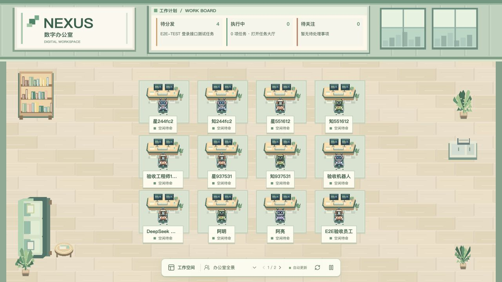
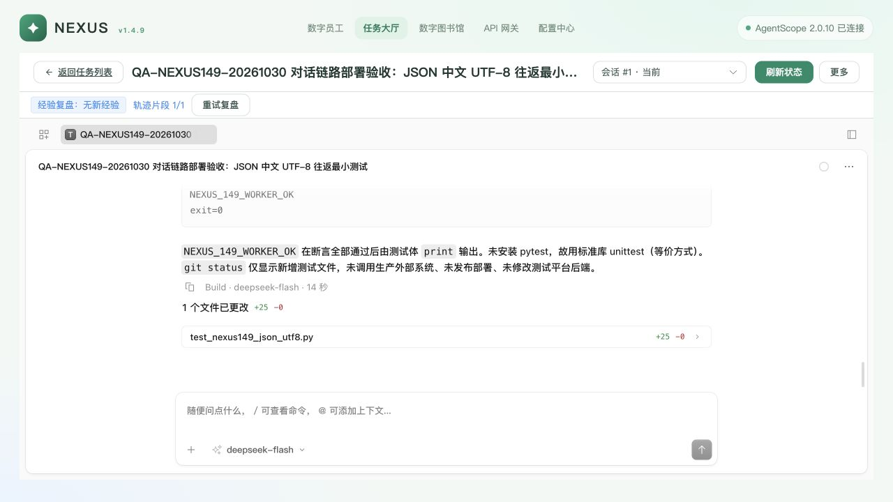

# Nexus v1.4.9 本机完整部署与真实验收

> 本文记录较早的 SQLite 验收。后续已切换 MySQL，当前部署事实与新一轮真实验证见 [MySQL 部署报告](nexus-v149-mysql-deploy-20261030.md)。下文作为历史证据保留。

日期：2026-10-30（Asia/Shanghai）。部署代码：`517fb35a0ab010ddabd3524d5e45a3964dafbc48`；工作区 `codex/nexus-chat-window-e2e`。本次已完成现有本机环境的服务切换、迁移、真实模型/群聊/Worker/ASR 与重启验证。历史目录数据和可选 Ollama 节点仍有问题，见末尾，不能据此称为公司生产环境全绿。

入口：<http://127.0.0.1:18520/>。由同一个 Nexus API 托管预构建前端，未使用 Vite 或受控上游工厂。

## 原因与修改

此前聊天审视使用受控上游；18120 的旧配置指向不可达 AgentScope。现有 18520 环境拥有真实 AgentScope、网关、Redis、MCP 与 Linux Worker，因此将集成版本部署到 18520，保留原数据库、身份、网关密钥和 Worker 配置。主目录的未提交 Runtime 修改没有被覆盖；未接管 18120 等其他入口。

部署时执行已发布的 `0006_employee_avatars` 新迁移，没有修改 init 或 stamp 数据库。API 原先仍报告 1.4.8，现统一从包内版本读取 1.4.9，更新项目 metadata 并补充 health / OpenAPI 断言。

真实上游的用户消息允许 `finished_at=null`，原界面会把这种消息误当作员工生成中，影响附件单发和排队提示。现将员工回复与用户/系统消息区分，增加反例回归；附件单发已通过真实模型验证。

ASR 路由对应的 19899 服务未运行。复用原已安装虚拟环境和本地 SenseVoiceSmall / VAD 文件，以 offline=true、auto_download=false 启动服务，按原节点策略完成两次真实探测；没有更换路由或下载模型。

## 进程、数据与备份

所有替换均核对 PID、create_time、cwd 和进程组，并使用 ops/dev/procman.py。切换前 Task 无 RUNNING、群讨论无 queued/running，Celery active/reserved/scheduled 为 0。旧 service-ctl 的失效记录未用于停止进程。

| 服务 | 当前 PID | 端口/入口 |
|---|---:|---|
| gateway | 52134 | 18511 |
| library-mcp | 52137 | 18512 |
| task-mcp | 52187 | 18502 |
| schedule-mcp | 52188 | 18503 |
| agent | 52191 | 18500 |
| api | 56506 | 18520 |
| celery-worker | 52193 | Celery 队列 |
| celery-beat | 52194 | Celery 队列 |
| asr | 52851 | 19899 |

Redis 18579 和原有 Worker/隧道沿用。当前业务库是现有显式 SQLite 开发/验收库 `/tmp/nexus-worker-experience-20261023/nexus.db`，AgentScope 使用同目录独立 agentscope.db；没有迁移到公司 MySQL。原数据路径保持不变。

受保护运维目录：`/Users/niuniu/.local/state/nexus/releases/v1.4.9-9de16224c/`，目录 0700，包含数据库备份、Redis RDB、workspace/blobs/qdrant 副本、原进程身份与环境、新进程清单和日志。环境与密钥文件为 0600，不提交 Git。

该目录的 manage.py 提供逐服务 status/start/stop/restart，加载持久化环境并复核进程身份。示例：

```bash
/Users/niuniu/程序/Astra/.venv/bin/python /Users/niuniu/.local/state/nexus/releases/v1.4.9-9de16224c/manage.py api status
```

重启基础设施前应先核对业务占用。迁移 0006 不猜测旧 Emoji，回滚需使用升级前备份；恢复前先备份当前数据并处理部署后新增的会话、任务，不覆盖在线库。没有安装 macOS 开机自启动项。

## 验证

| 项目 | 结果 |
|---|---|
| 后端全量 tests/platform + tests/nexus | 1436 passed，33 skipped；本轮 API 版本标识调整后再跑 test_api：49 passed |
| web 单元与构建 | 70 passed；类型检查和 build 通过，仍有大 chunk 提示 |
| chat-island | 沿用前轮同源码的 17 passed、类型与 build 通过结果；本轮未修改聊天岛 |
| Ruff | app、nexus_api、tests 全部通过 |
| API / AgentScope | health 1.4.9；AgentScope 2.0.10 configured/reachable=true |
| 实际前端 | 线上 JS 与本地 dist SHA-256 完全一致：`/assets/index-DFBq2DU2.js` |
| MCP | Library / Task / Schedule 无鉴权初始化均 401；带现有鉴权与会话身份初始化、tools/list 均 200，分别 4 / 20 / 3 个工具 |
| 真实模型 | 通过 Nexus 网关调用 deepseek-flash，返回 NEXUS_149_REAL_CHAT_OK 与 42，网关请求记录 200 |
| 真正停止 | 原生 REPLY_END 为 interrupted，is_running=false；没有用超时或页面猜测终态 |
| 群聊 | 真实创建 B/C 群组；普通消息保持 idle；两员工分别真实回复 GROUP_OK；discussion completed / turns=2 |
| ASR | 合成音频→Nexus API→网关→真实 SenseVoiceSmall，200，识别出 “This is a deployment test, 17 plus 25 equals 42.”；没有录制麦克风 |
| 原生任务工作台 | 真实渲染 Shell 工具调用、测试文件、差异与输出，非截图夹具 |
| 重启 | API PID 52192→56506；历史/附件与任务保持；B 新会话经真实模型返回 NEXUS_149_RESTART_OK |
| 最终占用 | Task / RuntimeSession SUCCEEDED；Worker IDLE、current_task_count=0；Celery active/reserved=0 |
| 浏览器 | 下列 11 个真实流程通过；最终新页面 error / warn 为空 |

浏览器流程：

1. 真实私聊：AgentScope→Nexus网关→模型，返回标记与42。
2. 真实停止：REPLY_END=interrupted，is_running=false。
3. 真实群聊创建与普通消息保持空闲。
4. 真实群聊 B/C 两轮模型回复，讨论 completed。
5. 数字员工实际创建/派发 Linux Worker，原生 bash 与文件证据验证 unittest 通过。
6. 真实首页16名员工分页12+4，默认办公室全景。
7. 真实附件单独发送：正文预览、模型回复，用户气泡无永久生成提示。
8. 真实任务原生工作台加载文件差异、Shell命令与真实输出。
9. 数字图书馆入口与既有知识列表正常。
10. API网关与配置中心正常打开，保留原配置。
11. 受控重启 API 后历史保持，B 新会话真实模型返回 RESTART_OK。

## 真实 Worker 闭环

由员工 A 在私聊中调用 Task MCP 创建并派发 `T-20261030-A2B360`，责任员工仍是 A，Worker 为现有共享 QA 执行资源 `qa-worker-experience-20261023`。

执行端为 LINUX_REMOTE，运行 Python 3.12.3，在独立 QA 仓库 worktree 内仅新增 test_nexus149_json_utf8.py。原生工具记录证明实际执行 `python3 -B -m unittest -v test_nexus149_json_utf8.py`，1 项测试通过，输出 NEXUS_149_WORKER_OK 与 exit=0。已独立读取任务绑定的原生工具记录及真实文件，不依赖数字员工的口头结论。Worker 未安装 pytest，本次使用标准库 unittest。

执行结束后 Task=WAITING / EXECUTION_RESULT_REVIEW，RuntimeSession=SUCCEEDED。经本次验收操作者确认业务完成，再由 A 调用 nexus_task_confirm，Task 才进入 SUCCEEDED。最后独立复查 Worker=IDLE、占用0、executing=false、waiting_human=false、worker_online/runtime_reachable=true；当前 Session ID 作为历史引用保留，不当作仍占用资源。

期间观察到一次 RUNTIME_DISCONNECTED，随后恢复 CONNECTED；任务状态保持 WAITING，原生工具记录和工作台可读取。尚未做长稳或网络故障压力验收。

## 效果与证据

真实办公室（12 人第一页）：



真实原生执行记录：



证据目录包含 deployment-proof.json、worker-native-tools.json、worker-test-file.json、worker-release.json、mcp-readiness.json、asr-real.json、gateway-real-requests.json、restart-proof.json 与浏览器检查/截图。原生消息证据仅保留必要字段，未保存运行上下文令牌或服务密钥。

## 尚未解决的环境问题

1. 原有 Nexus 目录16位员工，官方 AgentScope SQL 中5个 Agent；其中12位目录员工的绑定目标已经不存在，部分还没有模型路由。通过实际创建会话已复现 404；本轮使用持久化完整的 A/B/C 验证。没有猜测模型、自动重建 Agent 或覆盖其历史身份。详见 historical-bindings.json。
2. 可选 Ollama qwen2.5:3b 节点不可用，本机没有该模型的有效 manifest。保留现有配置，没有静默替换模型或下载大模型。网关总览因此仍显示降级；DeepSeek 和 SenseVoiceSmall 正常。
3. 沿用现有本机 SQLite 验收环境与 /tmp 数据路径；公司 MySQL 8.0.36、systemd、备份恢复演练、长期运行和多节点容量未验收。保留了受保护备份与可复用进程环境，但没有宣称公司生产部署已完成。
4. 麦克风权限、录音硬件与手机软键盘没有实测；ASR 结果来自已明确标识的合成音频。任务等待人工确认已真实验证，工具权限确认通道仍按原设计不提供本地伪确认。

本轮未推送远端；部署使用上述独立工作区的已提交代码。当前运行工作区需保留。旧的18563受控上游预览已按进程身份核对后停止，真实18520服务保留。
