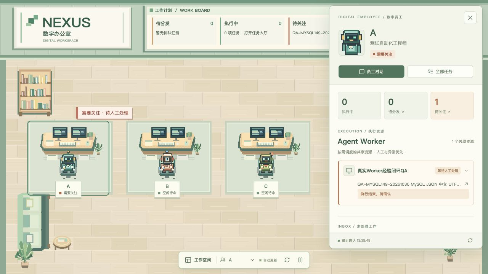
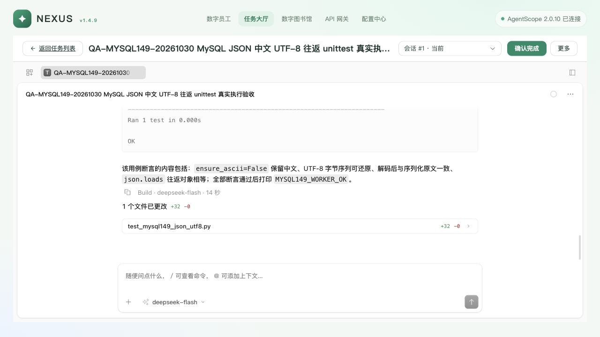

# Nexus v1.4.9 MySQL 部署与真实流程验收

日期：2026-10-30（Asia/Shanghai）。代码提交：`22ea08019`，分支 `codex/nexus-chat-window-e2e`。入口：<http://127.0.0.1:18520/>。

本次已将该入口切换到 MySQL 8.0.36，Nexus 与 AgentScope 分别使用独立库，并通过真实 DeepSeek、群聊、Linux Worker、业务确认、资源释放和全服务重启验证。这里是本机部署验收，不代表公司生产环境验收。

## 原因与修改

上一轮真实验收仍运行在显式 SQLite 开发库。本次按用户要求采用 MySQL；现有 3306 实例需要密码，当前配置没有可用凭据，用户也不掌握该密码。因此复用已安装的官方 MySQL 8.0.36 二进制，建立本期独立持久化实例 `127.0.0.1:18536`，没有重置或接管 3306。

按照仓库全新部署约定，Nexus 使用 `nexus_v149`，AgentScope 使用 `nexus_agentscope_v149`；分别生成只授权对应库的专用账号，凭据仅保存在本机受保护运维目录。没有导入 SQLite 业务历史，没有修改已发布 init，也没有 stamp 或运行时兼容分支。

通过现有控制面重新登记 DeepSeek、ASR、A/B/C、任务分类、QA 仓库和共享 Worker。原 12 位缺少 Agent 绑定的员工按用户要求暂不处理，保留在旧环境及备份中；新入口当前展示 A/B/C 三位已真实创建并同步的员工。

真实群聊发现 MySQL 1064：`SELECT MAX(id) AS cursor` 使用了 MySQL 保留字作为未转义别名。现改为 `event_cursor`，保持对外响应字段不变。新增真实 MySQL 回归，覆盖三个历史入口、事件游标及翻页；修复前复现失败，修复后通过。

## 部署事实

| 项目 | 实际结果 |
|---|---|
| MySQL | 8.0.36；18536；InnoDB；utf8mb4；REPEATABLE-READ；业务连接时区 +00:00；STRICT_TRANS_TABLES |
| Nexus schema | `0006_employee_avatars`，官方 Alembic upgrade head |
| AgentScope schema | 官方 2.0.10 / `0004_sops`；messages.created_at 为 DATETIME(6)，init/check 均通过 |
| 数据归属 | 员工目录、会话绑定、Task/Worker/网关在 Nexus 库；Agent/Session/消息在独立 AgentScope 库 |
| Redis | 独立 18589，AOF 与 RDB；AgentScope DB 0，平台 DB 1 |
| 模型节点 | DeepSeek 官方根地址；实际 API 模型 ID `deepseek-flash`，沿用之前 v4.1 配置 |
| 上游核实 | 使用现有节点凭据实际 GET /models：200，包含 deepseek-flash、deepseek-v4-pro；没有猜造 deepseek-v4.1-flash 别名 |
| 前端 | API 托管现有 dist；线上 JS 与本地 SHA-256 一致，非 Vite、非受控上游工厂 |
| 控制机 | worker 模式；实际执行发生在 Linux QA Worker 的独立任务 worktree |

受保护运维目录：`/Users/niuniu/.local/state/nexus/releases/v1.4.9-mysql-e950abb50/`。目录 0700；凭据、环境、备份和配置源不进入 Git。目录名记录部署起点，`processes.json` 的 release 记录实际代码提交。

目录内 `manage.py` 按 PID、create_time、cwd 和进程组管理服务，`restart_all.py` 在任务、对话、群讨论与 Celery 空闲后执行备份及有序重启，`verify.py` 仅生成脱敏证据。MySQL/Redis 的受管 cwd 使用其实际数据目录，避免守护进程切换 cwd 后身份核对失配。

```bash
/Users/niuniu/程序/Astra/.venv/bin/python /Users/niuniu/.local/state/nexus/releases/v1.4.9-mysql-e950abb50/manage.py api status
```

重启后进程快照如下，PID 是验收时快照，后续以身份记录和实际进程为准。

| 服务 | PID | 端口 |
|---|---:|---:|
| MySQL | 60986 | 18536 |
| Redis | 60988 | 18589 |
| Gateway | 60990 | 18511 |
| Library MCP | 60992 | 18512 |
| Task MCP | 60994 | 18502 |
| Schedule MCP | 60996 | 18503 |
| AgentScope | 60998 | 18500 |
| Nexus API + Web | 61000 | 18520 |
| Celery worker | 61004 | — |
| Celery beat | 61006 | — |
| ASR（沿用真实服务） | 52851 | 19899 |

已逐一读取八个数据库消费者的真实进程环境，确认均使用上述两个 MySQL 库。Nexus 新数据目录未生成业务 SQLite 文件。原 3306、18579、18120 等非本期实例未接管。

## 验证结果

| 验证 | 结果 |
|---|---|
| 后端全量 tests/platform + tests/nexus | **1439 passed，31 skipped**；其中群聊 MySQL 测试显式连接独立 MySQL 8.0.36 |
| 独立 MySQL Runtime 并发回归 | **16 passed**，每例独立建库与迁移 |
| 群聊与相关回归 | **31 passed**；新增历史入口回归修复前失败、修复后通过 |
| Ruff | app、nexus_api、tests 全部通过 |
| 前端 | 本轮未改前端，沿用前轮 70 单测与类型/build 结果；本轮重新核对实际部署包 SHA 和真实页面 |
| 真实私聊 | AgentScope → Nexus Gateway → DeepSeek，MYSQL149_CHAT_OK 与 42 |
| 群聊 | 普通消息无讨论；@B @C 后两员工实际回复 MYSQL149_GROUP_OK，discussion completed / turns=2 |
| 停止生成 | 实际点击停止；原生 finished_reason=interrupted，is_running=false |
| 附件 | 单独发送的 Markdown 在原生用户消息中包含正确正文；模型完成回复；正文澄清后实际读出 MYSQL149_ATTACHMENT_OK，用户消息未永久显示生成中 |
| ASR | 合成 WAV → API → Gateway → 真实 SenseVoiceSmall，200，正确识别 17+25=42；未录制麦克风 |
| MCP | Library/Task/Schedule 未鉴权均 401；携带真实服务凭据及 Task/Session 身份后 initialize、tools/list 均 200；会话已关闭 |
| 首页工作台 | 当前员工关联真实共享 Worker；等待确认时明确显示问题和任务入口，完成后恢复空闲 |
| 原有入口 | 任务大厅、原生任务工作台、图书馆、网关、配置中心与 Worker 列表均实际打开 |
| 全服务重启 | MySQL、Redis、Gateway、三 MCP、AgentScope、API、Celery worker/beat 全部停止后重新启动；SQL 中 ID、消息、附件和任务保留，新推理返回 MYSQL149_RESTART_OK |
| 备份恢复 | 两库一致性 mysqldump 在另一个隔离 MySQL 8.0.36 实例实际恢复成功，版本、3 员工、3 Agent 和任务 SUCCEEDED 正确；恢复验证实例已停止 |
| 最终占用 | Task / RuntimeSession SUCCEEDED，Worker IDLE / 0，原生连接 CONNECTED；Celery active/reserved/scheduled 均 0 |
| 浏览器 | 11 项实际流程记录；最终首页 console error/warn 为空 |

后端有既有弃用告警；跳过项不视为通过。未重复运行未改动的前端测试。

## 真实 Worker 闭环

任务 `T-20261030-7FE48C`，原生会话 `ses_e74b0b9eaffem1Up00X32LF0eB`，Worker `qa-worker-experience-20261023`。数字员工 A 是责任人；Worker 没有永久绑定数字员工。

新库初始 Worker 装备状态为 pending，Task MCP start 正确拒绝。随后通过官方维护入口完成部署，操作 `op_d71f22ca1760474291db2df3b2a61770` 为 SUCCEEDED，装备 revision applied；同一任务被调度执行，没有重复建单。

Linux Worker 在该任务隔离目录仅新增 `test_mysql149_json_utf8.py`，实际执行 `python3 -B -m unittest -v test_mysql149_json_utf8.py`：1 项测试通过，输出 MYSQL149_WORKER_OK、EXIT_CODE=0。独立读取了原生 bash/write/edit/read 记录与实际文件，没有把员工口头报告当作执行证据。

执行结束时 RuntimeSession=SUCCEEDED，Task=WAITING / EXECUTION_RESULT_REVIEW。任务提示真实唤醒 A，A 查询任务并回报。验收操作者独立核实后在员工对话确认业务完成，A 调用 nexus_task_confirm，Task 才变为 SUCCEEDED，Worker 释放至 IDLE / 0。复查了数据库、原生会话与 Worker 健康事实。

任务复盘生成一条经验草稿，图书馆显示“待人工审核 / 未验证”；没有人工批准或发布为正式知识。

## 仍需关注

- 这是独立新库部署，旧 SQLite 历史没有迁入；12 位缺少 Agent 绑定的员工按要求暂缓。原数据、进程环境及切换前快照仍保留，恢复旧入口前还须先备份当前 MySQL，并恢复 QA Worker 对应环境文件，不能只重启旧 API。
- 停止测试的一次 Gateway 请求被记为 `CLIENT_DISCONNECTED`（传输状态 200，同时记录中断错误），并出现过一次熔断打开事件；后续模型调用成功，最终节点可服务、并发为 0。本次没有改变既有网关健康策略，不能把该记录归为 DeepSeek 服务故障。
- 附件单发后，模型首轮选择继续回答此前被中断的问题；明确正文要求读取附件标记后正确返回。原生消息已证明附件正文正确送达，这属于本次观察到的模型交互行为，不宣称所有附件问法都能得到预期回复。
- 未做长稳、多控制机副本、故障注入、公司网络/TLS 或 macOS 开机自启动验收。本机受管重启与隔离备份恢复不能替代公司生产验收。

## 效果与证据

验收期间的真实人工确认工作台：



原生任务执行结果：



全部脱敏证据位于 [evidence/nexus-v149-mysql-deploy-20261030](evidence/nexus-v149-mysql-deploy-20261030/)：部署/SQL/进程/重启、备份恢复、Worker 原生工具与文件、释放状态、群聊、停止、ASR、Gateway 请求元数据、MCP readiness、测试日志及九张截图。凭据扫描通过。
