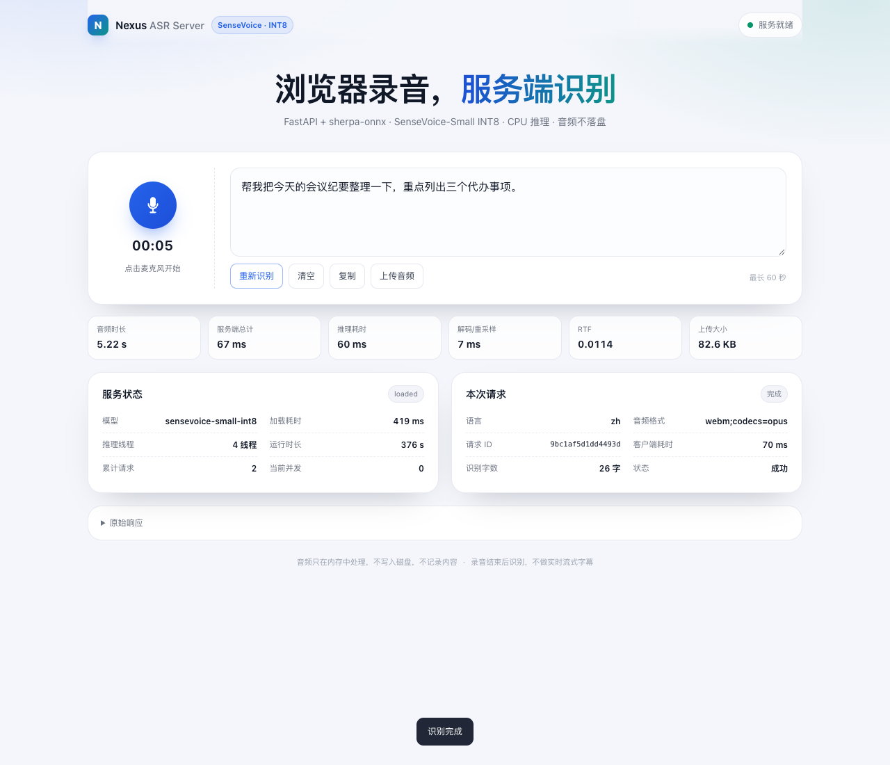

# Nexus ASR Server

独立的浏览器录音 + 服务端语音识别服务：**FastAPI + sherpa-onnx + SenseVoice-Small INT8**，CPU 推理，不依赖 GPU、不调用云端 ASR、不使用 AgentScope 语音能力。

浏览器负责录音，服务端统一解码为单声道 16 kHz PCM 并识别，返回文字、音频时长和耗时。音频只在内存中处理，不落盘、不记录内容。



## 实测结论（Mac M4）

| 场景 | 服务端总耗时（p50） | 说明 |
|---|---:|---|
| 5 s 中文 WAV | **56 ms** | 5 条实测 55.9–56.9 ms |
| 5 s 中文 WebM/Opus | **65 ms** | Chrome MediaRecorder 实际格式 |
| 10 s 中文 | **100 ms** | 99.6–102.0 ms |
| 30 s 中文 | **332 ms** | 331–347 ms |
| RTF | **0.010–0.011** | 远低于 1 |
| 20 次连续识别 | 20/20 成功，p50 61 ms | 无失败、无重启 |
| 8 并发 5 s | 8/8 成功，墙钟 419 ms | 并发上限 2 |
| 服务重启到 /health | **802 ms** | 模型加载 419 ms |
| 断网启动 + 识别 | 通过 | 模型已存在，`NEXUS_ASR_OFFLINE=1` |
| 内存 RSS | 约 **796–800 MB** | 模型 + ONNX Runtime + 2 并发 |
| 30 s 解码 CPU | 约 **3.6 个核** | `num_threads=4` |

**5 秒录音结束后 1 秒内出字：达标，且余量很大（约 56–65 ms）。**

准确率（CER，去掉标点/空格后按字符计算）：

| 样本 | CER |
|---|---:|
| 中文 5 s（TTS） | 4.2% |
| 中文 10 s（TTS） | 4.7% |
| 中文 30 s（TTS） | 8.0% |
| 中英混合 1 | 21.5% |
| 中英混合 2 | 9.6% |
| 官方真人中文 `zh.wav` | **0.0%**（“开放时间早上9点至下午5点。”） |
| 官方真人英文 `en.wav` | **0.0%** |

混合样本用中文 TTS 读英文技术术语，sherpa-onnx / SenseVoice / INT8 / FP32 / Vue3 等仍有明显错误；普通中英混句正常。详见 [性能报告](docs/performance-report.md)。

## 架构

```text
浏览器
  getMediaRecorder / WebM(Opus)
        │  POST /api/asr/transcribe  (multipart)
        ▼
Nginx（HTTPS、公司登录）→ 统一 Nexus API（身份、已保存的语音路由）
        ▼ POST /v1/audio/transcriptions
Nexus API 网关（Key 授权、别名、调度、并发、调用元数据）
        ▼ POST /v1/audio/transcriptions
独立 ASR FastAPI (1 worker)
  ├─ 上传分块读取 + 大小限制
  ├─ asyncio.Semaphore（并发上限）
  ├─ ThreadPoolExecutor（解码 + 推理，不阻塞事件循环）
  ├─ PyAV/FFmpeg：WAV / WebM / MP4 -> mono 16 kHz PCM
  ├─ sherpa-onnx OfflineRecognizer（启动时加载一次）
  └─ 返回 text / duration / elapsed_ms / rtf
```

- 模型：SenseVoice-Small INT8（228 MB），Silero VAD 不参与服务端识别（整段音频直接识别）。
- **不做实时流式字幕**：录音结束后识别。
- 同机服务默认只监听 `127.0.0.1`；跨机只向网关主机开放内网端口，浏览器不直连。

## Mac 快速开始

前置：macOS ARM64、Python 3.12（脚本可用 `uv` 自动准备）。

```bash
cd services/nexus-asr

./setup-mac.sh          # 创建 .venv 并安装依赖（Python 3.12）
./download-model.sh     # 下载 228 MB 模型并校验 SHA256
./start-mac.sh          # 启动 http://127.0.0.1:19899/
```

打开 <http://127.0.0.1:19899/> 即是测试网页：

- 点击麦克风开始录音，再次点击结束；
- 自动上传并显示识别文字；
- 显示音频时长、服务端总耗时、推理耗时、解码耗时、RTF、上传大小；
- 支持“重新识别”（复用上一段录音）、“上传音频”、复制、清空；
- 不自动发送，识别结果可继续编辑。

API：

```bash
curl http://127.0.0.1:19899/health

curl http://127.0.0.1:19899/api/asr/models

curl -X POST \
  -F "file=@testdata/zh-5s.wav" \
  http://127.0.0.1:19899/api/asr/transcribe
```

响应示例：

```json
{
  "text": "帮我把今天的会议纪要整理一下，重点列出三个代办事项。",
  "duration": 5.03,
  "elapsed_ms": 52.5,
  "decode_ms": 3.2,
  "total_ms": 56.1,
  "rtf": 0.0104,
  "model": "sensevoice-small-int8",
  "language": "zh",
  "request_id": "b6100236fab744cf"
}
```

## 配置

`config.yaml` 是唯一事实源；少量部署项可用 `NEXUS_ASR_*` 环境变量覆盖。

```yaml
server:
  host: 127.0.0.1
  port: 19899
  max_upload_mb: 12
  max_audio_seconds: 60
  max_concurrency: 2
  queue_timeout_seconds: 5
  request_timeout_seconds: 30
  rate_limit_per_minute: 120
  trust_proxy_headers: true
  docs_enabled: true

asr:
  provider: sherpa-onnx
  model: sensevoice-small-int8
  model_dir: ./models/sensevoice-small-int8
  device: cpu
  num_threads: 4
  language: auto        # auto | zh | en | ja | ko | yue
  use_itn: true
  auto_download: true
  offline: false
```

- 环境变量：`NEXUS_ASR_CONFIG`、`NEXUS_ASR_HOST`、`NEXUS_ASR_PORT`、`NEXUS_ASR_LOG_LEVEL`、`NEXUS_ASR_MODEL_DIR`、`NEXUS_ASR_NUM_THREADS`、`NEXUS_ASR_MAX_CONCURRENCY`、`NEXUS_ASR_AUTO_DOWNLOAD`、`NEXUS_ASR_OFFLINE`。
- `.env.example` 可复制为 `.env`；systemd 也会读取 `/opt/nexus-asr/.env`。
- `rate_limit_per_minute` 是进程级保护；生产按 IP 的严格限流放在 Nginx（示例 30 r/min）。

## 模型管理

模型文件与源码分离，`models/*/` 已在 `.gitignore` 中。

```bash
# 下载 / 校验
./download-model.sh
.venv/bin/python -m app.model_store --check

# 离线模式（禁止任何下载）
NEXUS_ASR_OFFLINE=1 ./start-mac.sh
```

- 文件：`models/sensevoice-small-int8/model.int8.onnx`（239,233,841 B）+ `tokens.txt`（315,894 B）。
- SHA256：
  - `model.int8.onnx` = `c71f0ce00bec95b07744e116345e33d8cbbe08cef896382cf907bf4b51a2cd51`
  - `tokens.txt` = `f449eb28dc567533d7fa59be34e2abca8784f771850c78a47fb731a31429a1dc`
- 来源：sherpa-onnx 官方模型 `csukuangfj/sherpa-onnx-sense-voice-zh-en-ja-ko-yue-2024-07-17`。
- 启动时先校验大小 + SHA256，再加载模型；加载成功后才对外服务。缺失且允许下载时自动下载；离线且缺失时启动失败并给出明确提示。
- 固定 `sherpa-onnx==1.13.2`：1.13.6+ 在官方 `zh.wav` 上把“开放时间”识别成“开饭时间”，1.13.2 与官方参考一致。速度差异可忽略（5 s 约 56 ms）。

## 测试

```bash
# 单元/API（21 项）
.venv/bin/python -m pytest -q tests

# 完整 HTTP 性能 + 并发 + 资源（需要服务已启动）
.venv/bin/python scripts/perf_test.py --output results/perf-mac.json

# 浏览器 MediaRecorder -> WebM -> API 全链路（需要 Chrome + Playwright）
node tests/browser-test.mjs
```

`tests/browser-test.mjs` 默认使用仓库里的 `frontend/node_modules/playwright`；也可设置 `PLAYWRIGHT_PATH`。

## Linux ARM64 部署

见 [Linux ARM64 部署文档](docs/deployment-linux-arm64.md)。

- `scripts/prepare-linux-wheels.sh`：在 Mac 下载 Linux ARM64 的完整 wheel 集合（20 个，约 66 MB）。
- `install-offline.sh`：校验 aarch64 / Python 3.12 / glibc >= 2.28，创建本地 venv，离线安装，不碰系统 Python，不影响 Nexus 已有服务。
- `start-linux.sh`、`deploy/nexus-asr.service`、`deploy/nginx-nexus-asr.conf`。
- 目标机要求：Linux ARM64、glibc >= 2.28（PyAV 要求）、Python 3.12、systemd、Nginx。
- **说明**：本次开发环境没有 Linux ARM64 实机或 Docker，wheel 集合只做了离线解析验证；上线前需在目标服务器执行验收清单。

## Nexus 集成

见 [Nexus 集成说明](docs/nexus-integration.md)。

实际聊天输入框在 `services/nexus-api/chat-island`（React 19，由 Vue 3 页面以 iframe 嵌入）。已在：

- `chat-island/src/hooks/useAsrRecorder.ts`：录音 / 上传 / 状态机 / 重试；
- `chat-island/src/components/chat/TextInput.tsx`：新增麦克风按钮、状态提示、按光标插入文字；
- `chat-island/src/i18n/locales/{zh,en}.json`：文案；
- `chat-island/vite.config.ts` 与 `web/vite.config.ts`：开发请求交给统一 Nexus 服务；
- `web/src/views/DigitalEmployeeChatView.vue`：iframe 增加 `allow="microphone"`。

浏览器统一调用 `/api/asr/transcribe`，由 Nexus 验证身份并通过已保存的 ASR 网关路由调用独立模型 API；生产和开发均不直接代理到固定本机端口。配置步骤见上述集成说明。

## 目录

```text
services/nexus-asr/
├── app/
│   ├── main.py           # FastAPI、并发/超时/限流、错误处理
│   ├── config.py         # config.yaml + 环境变量
│   ├── model_store.py    # 校验 / 下载 / 自动安装
│   ├── audio.py          # PyAV 解码 + 16 kHz 单声道重采样
│   ├── engine.py         # sherpa-onnx SenseVoice 封装
│   └── limiter.py        # 进程级滑动窗口限流
├── static/               # 录音测试网页
├── tests/                # pytest + 浏览器全链路
├── scripts/perf_test.py  # 真实 HTTP 性能测试
├── models/               # 模型（gitignore）
├── wheels/               # Linux ARM64 离线依赖（gitignore）
├── deploy/               # systemd + Nginx 示例
├── config.yaml / .env.example / requirements*.txt
├── setup-mac.sh / start-mac.sh / download-model.sh
└── start-linux.sh / install-offline.sh
```

## 隐私与限制

- 音频只在内存中解码，不写磁盘；日志只记录字节数、时长、耗时、状态，不记录音频或识别文本。
- 服务单进程单 worker，模型只加载一次；多 worker 会重复占用内存，不推荐。
- `max_concurrency=2`，`num_threads=4`；在共享机器上可把 `num_threads` 降到 2、并发降到 1。
- 不支持实时流式字幕；首版为录音结束后整段识别。
- 中英混合技术术语仍有错误，建议前端保留可编辑文本，必要时加领域术语纠错。
