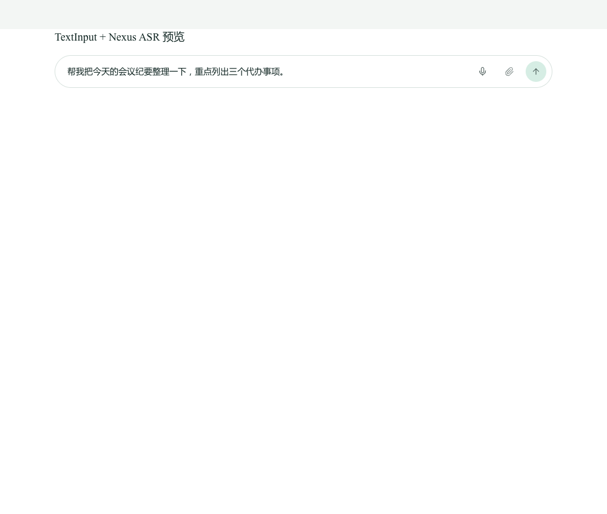

# Nexus 前端集成说明

## 1. 现状与落点

Nexus v1.4.8 的聊天输入并不在 Vue 组件里，而是在 **chat-island（React 19）**：

```text
services/nexus-api/web/src/views/DigitalEmployeeChatView.vue   (Vue 3 外壳)
  └── <iframe class="chat-island" src=".../nexus-chat/...">    (同源 iframe)
        └── services/nexus-api/chat-island/src/components/chat/TextInput.tsx
              └── 实际的 textarea / 发送 / 语音按钮
```

因此本次把麦克风做进了实际输入框 `TextInput.tsx`，而不是在 Vue 页面外层再放一个悬浮按钮。Vue 外壳只增加了一行 `allow="microphone"`，让 iframe 内的 `getUserMedia` 获得权限。

> 如果后续聊天输入迁到 Vue，本页的接口和状态机可以直接复用；录音与上传逻辑已经集中在 `useAsrRecorder`，不依赖聊天组件的其它状态。

## 2. 用户流程

1. 输入框右侧出现一个新的麦克风按钮（与原有实时语音 `AudioLines` 按钮区分）。
2. 点击开始录音；按钮变为红色方块，输入框上方显示“录音中 00:05”。
3. 再次点击结束；按钮变为 spinner，显示“正在识别…”。
4. 识别结果 **插入到当前光标位置**，保留已有草稿；textarea 获得焦点，光标在插入文字之后。
5. 用户可以继续编辑，按 Enter 发送（复用原有 `handleSend`），**不会自动提交**。
6. 失败时显示错误与“重试”链接；重试复用上一段录音。权限被拒绝会提示去浏览器设置。
7. 停止录音即释放麦克风轨道；空闲时不保持后台录音。



## 3. 服务端调用

浏览器统一使用相对路径：

```http
POST /api/asr/transcribe
Content-Type: multipart/form-data
file=recording.webm
```

- 请求体上限 12 MB；录音上限 60 s（hook 内自动停止）。
- 浏览器优先 `audio/webm;codecs=opus`；不支持时退回 `audio/webm` / `audio/mp4`。
- 响应使用 `text` 回填；`request_id`、`total_ms` 等字段当前不展示在聊天 UI，但保留在响应里，便于排障。

本地开发：

- `services/nexus-api/web/vite.config.ts` 增加 `/api/asr` → `http://127.0.0.1:19899`（仅 dev/preview）。
- `services/nexus-api/chat-island/vite.config.ts` 同样增加，便于单独调试 chat-island。
- 可用 `VITE_NEXUS_ASR_PROXY_TARGET` 覆盖目标地址。

生产：

- 浏览器只访问 Nexus 的 HTTPS 域名；
- Nginx 把 `/api/asr/transcribe`、`/api/asr/models` 反代到 `127.0.0.1:19899`；
- 复用 Nexus 现有登录鉴权（`auth_request` 或等价机制）；
- 应用内按 IP 限流 30 r/min（示例）+ 服务内 120 r/min 全局保护；
- ASR 服务本身不对外监听。

配置见 [`deploy/nginx-nexus-asr.conf`](../deploy/nginx-nexus-asr.conf)。

## 4. 代码结构

| 文件 | 改动 |
|---|---|
| `services/nexus-api/chat-island/src/hooks/useAsrRecorder.ts` | 新增：`getUserMedia` / MediaRecorder / 60 s 自动停止 / 上传 / 状态机 / 重试 |
| `services/nexus-api/chat-island/src/components/chat/TextInput.tsx` | 新增麦克风按钮、录音状态行、按光标插入、重试入口；新增 `localAsrEnabled` prop |
| `services/nexus-api/chat-island/src/i18n/locales/zh.json` | 新增 `asr.*` 文案 |
| `services/nexus-api/chat-island/src/i18n/locales/en.json` | 同上 |
| `services/nexus-api/chat-island/vite.config.ts` | 独立开发时 `/api/asr` 代理 |
| `services/nexus-api/web/vite.config.ts` | Vue dev/preview 的 `/api/asr` 代理 |
| `services/nexus-api/web/src/views/DigitalEmployeeChatView.vue` | iframe 增加 `allow="microphone"` |

### 录音状态机

```text
idle ──点击──> (getUserMedia) ──> recording ──点击/60s──> transcribing ──成功──> idle
  ▲                                  │                         │
  └──────────────── 失败/<重试> ─────┴──────── error <──────────┘
```

- `recording` 时再次点击停止；`transcribing` 时按钮禁用，防止重复请求。
- 停止时立刻 `track.stop()`，不等上传完成。
- 上传超时 60 s（AbortController）；错误码映射为中文/英文提示。
- 记住 `lastBlob` 用于“重试”；新一轮录音会覆盖。

### 插入而非覆盖

```ts
const start = textarea.selectionStart;
const end = textarea.selectionEnd;
const next = value.slice(0, start) + text + value.slice(end);
```

- 中文直接拼接；英文/数字边界补一个空格；
- 插入后 `focus()` 并把光标放到插入文本末尾；
- 不调用 `onSend`，不自动提交。

### 开关

- 构建时设置 `VITE_NEXUS_ASR_ENABLED=false` 可隐藏本地 ASR 麦克风按钮；
- 默认开启；
- 关闭后不影响原有实时语音按钮、附件、发送。

## 5. 验证

已执行：

```bash
cd services/nexus-api/chat-island
npm run type-check     # 通过
npm run build          # 通过（输出到 services/nexus-api/web/public/nexus-chat）
```

服务端链路已用独立测试页 + Playwright 验证：Chrome 假麦克风 → MediaRecorder WebM → `/api/asr/transcribe` → 文字回填，5.22 s 录音服务端总耗时约 80–100 ms。

**未执行完整 Nexus UI E2E**：需要完整的 Nexus API / AgentScope / 登录环境；当前只做了 chat-island 的类型检查、生产构建和服务端 API 全链路验证。上线前建议在测试环境补一次：登录 → 打开私聊 → 点击麦克风 → 停止 → 文字插入 → 编辑 → 发送。

## 6. 注意事项

- **鉴权**：Nginx 精确匹配的 `/api/asr/*` 不会自动继承 `/api/` 下的 `auth_request`，必须显式配置，否则会绕过登录。
- **麦克风权限**：iframe 已加 `allow="microphone"`；如果 Nexus 使用 Permissions-Policy，需允许 `microphone=(self)`。
- **HTTPS**：生产必须 HTTPS（或 localhost），否则 `getUserMedia` 不可用。
- **ASR 服务不可用**：按钮仍显示，点击后在状态行提示失败并可重试；不影响打字和发送。
- **模型首次启动**：ASR 服务启动时加载模型；未就绪时 `/api/asr/transcribe` 返回 503，前端提示“语音服务尚未就绪”。
- **不自动提交**：识别文字只进入输入框，最终发送仍由用户按 Enter/发送按钮决定。
- **隐私**：音频只上传到同源 `/api/asr/transcribe`，服务端内存处理、不落盘、不记录文本；DevTools Network 中可见上传请求，但不会被第三方接收。
- **并发**：ASR 服务 `max_concurrency=2`；Nginx 按 IP 限流。用户连续快速点击会被前端状态机阻止，服务端仍有兜底。
